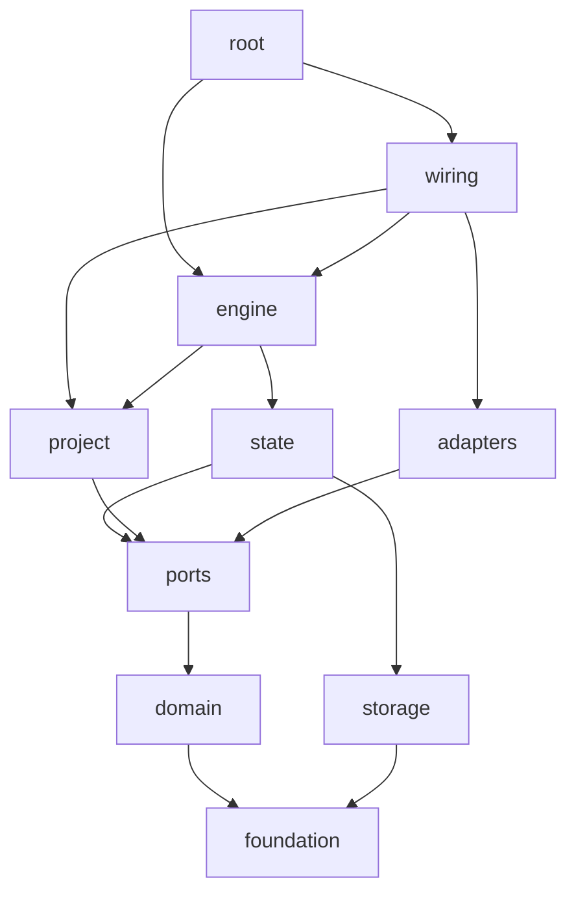

# Dependencies between modules

`src/factory` is layered.
`tests/test_layers.py` parses the imports of every module, lazy imports and `TYPE_CHECKING` imports included, and fails on any import cycle and on any import that breaks a rule below.
A module that is in no group fails it too, so a new module picks its group in the test.

## Groups

| Group | Modules | May import |
| --- | --- | --- |
| foundation | `clock`, `events`, `front_matter`, `git`, `names`, `spawn`, `states`, `values` | foundation |
| domain | `deciders`, `fingerprint`, `gates`, `library_lookup`, `pipeline`, `pipeline_checks`, `throttle` | foundation |
| ports | `executor`, `sandbox`, `tracker`, `workbench` | foundation, domain |
| adapters | `claude_code`, `github`, `gitlab`, `sbx`, `tracker_cli` | foundation, domain, ports |
| project | `config` | foundation, domain, ports |
| storage | `commands`, `custody`, `journal` | foundation |
| state | `artifacts`, `metrics`, `projection`, `question`, `recovery`, `run_state`, `run_view`, `stats`, `timeline` | foundation, domain, ports, storage |
| engine | `attempt`, `clean`, `decision`, `merge_window`, `orchestrator`, `sleep_block` | foundation, domain, ports, project, storage, state |
| wiring | `render`, `wiring` | foundation, domain, ports, adapters, project, storage, state, engine |
| root | `cli` | every group but adapters |

A group may always import its own modules.
Only `wiring`, the composition root, and `render`, the entry point of the renderer process, import an adapter, and the adapter classes that live in `sandbox` and `workbench`.
`wiring` is the top of the graph, and `cli` takes `Machine` from it.

## Graph

Every group also imports the foundation, and `wiring`, `root`, `engine`, `state` and `project` import the domain.
The arrows show the main direction only.

## What the layers keep apart

- The domain model (`pipeline`, `throttle`, `fingerprint`, `library_lookup`) imports no port.
  The ports import it: `executor` uses `Profile` from `pipeline` and `WindowUsage` from `throttle`.
- `Read` lives in `pipeline`, and `library_lookup` imports `pipeline`, so the two no longer import each other.
- `fingerprint` takes the kit hash as a function, not the `Executor`.
- `TERMINAL_NODES` lives in `states`.
- `journal` stores the payload of a brake, and `run_view` words it, so `journal` imports neither `pipeline` nor `throttle`.
- `run_state` keeps only the state the Journal replays, so it imports neither `executor`, `sandbox` nor `workbench`.
  `live` holds what the Orchestrator's process adds: `LiveTicket` with the running agent and Probe, the handles
  (`AttemptHandle`, `Process`, `AttemptTerminal`) and `Silence`.
- The Executor tells progress (`is_progress`) and renders its stream (`render_line`), so only `claude_code` reads a Claude event.
  `Silence` asks the Executor, and `render`, which runs as one process per Attempt, renders through the Executor
  named on its command line, so `workbench` passes the name of the Attempt's Executor on.
- `Failure` lives in `states`, so `run_state` needs no `executor` for it, and `marker` lives in `workbench`.
- `names` holds `integration_branch`, `ticket_branch`, `abandoned_ref` and `sandbox_name`, so `clean` imports neither `orchestrator` nor `attempt`.

## Known exceptions

None. A rule that needs an exception is a rule to change here and in the test together.
