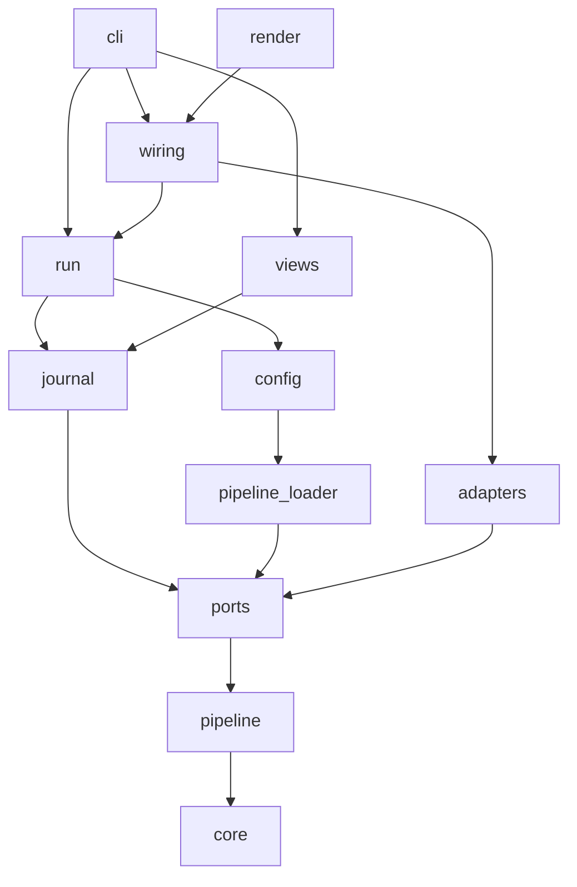

# Dependencies between modules

`src/factory` is layered, and each layer is a package.
`tests/test_layers.py` parses the imports of every module, lazy imports and `TYPE_CHECKING` imports included, and fails on any import cycle and on any import that breaks a rule below.
The test reads the group of a module from the tree: a module of a package is in the package's group, and a module at the top of `src/factory` is a group of its own.
It keeps only the table of which group may import which, so a new module picks its group by the package it goes in, and a new package or top-level module needs a row in the table.

## Groups

| Group | Modules | May import |
| --- | --- | --- |
| `core/` | `clock`, `events`, `front_matter`, `git`, `names`, `run_agent`, `sleep_block`, `spawn`, `states`, `values` | nothing |
| `pipeline/` | `deciders`, `fingerprint`, `gates`, `library_lookup`, `pipeline`, `pipeline_checks`, `throttle` | core |
| `ports/` | `executor`, `kind`, `run_ports`, `sandbox`, `tracker`, `workbench` | core, pipeline |
| `adapters/` | `claude_code`, `github`, `gitlab`, `local_sandbox`, `local_tracker`, `orca_card`, `sbx`, `terminal_workbench`, `tracker_cli` | core, pipeline, ports |
| `pipeline_loader` | `pipeline_loader` | core, pipeline, ports |
| `config` | `config` | core, pipeline, ports, pipeline_loader |
| `journal/` | `artifacts`, `commands`, `custody`, `journal`, `metrics_memory`, `projection`, `question`, `recovery`, `run_state`, `timeline_memory` | core, pipeline, ports |
| `views/` | `metrics`, `run_view`, `stats`, `timeline` | core, pipeline, ports, journal |
| `run/` | `attempt`, `ci_fix`, `ci_guard`, `ci_wait`, `clean`, `decision`, `inbox`, `inputs`, `issue_filing`, `isolation`, `landing`, `live`, `merge_window`, `moves`, `operations`, `orchestrator`, `probes`, `run_agents`, `run_context`, `run_decision`, `run_entry`, `run_start`, `run_tools` | core, pipeline, ports, pipeline_loader, config, journal |
| `wiring` | `wiring` | every group but render and cli |
| `render` | `render` | every group but adapters and cli |
| `cli/` | `cli` | every group but adapters and render |

A group may always import its own modules.
Only `wiring`, the composition root, imports an adapter, which `tests/test_layers.py` checks on the table.
`render`, the entry point of the renderer process, reads the Attempt events and takes from `wiring` only the normalizing of an Attempt from before them and the card that its `--card` names.
`wiring` is the top of the graph, and `cli` takes `Machine` from it.
`cli` enters the engine only through `run_entry`, which `tests/test_layers.py` checks, and takes the `Ports` of a Run and the `Cleaner` of `factory clean` from `Machine`.
`sleep_block` imports nothing of the package and wraps a host helper, as `spawn` does, so it is in `core` and `cli` holds the block of sleep while a Run goes.
`cli` is a package, and the test counts it as one module of the graph.
It holds `main` and the parser in `__init__`, one module per command (`check`, `run`, `status`, `stats`, `decide`,
`cancel`, `override`, `limits`, `resume`, `finish`, `clean`, `attach`, `library`) and `common` for what several commands share:
the host tool errors, the Tracker of a Spec, an orphaned Run taken from the Journal
and driving a Run to its end.
No module of the package imports more than half of `src/factory`.

## Fan-out ceilings

`tests/test_layers.py` also caps how many modules each module and each package imports, its Ce, so a hub cannot grow back.
A module imports at most 20 modules (`MAX_CE`), and `cli`, `wiring`, `orchestrator`, `attempt` and `run_start` sit at that ceiling.
A package imports at most the modules outside it that `PACKAGE_CE` gives, set to what `make measure-coupling` counted after #249, under Follow-ups of `coupling.md`:
`core` 0, `pipeline` 5, `ports` 5, `adapters` 12, `journal` 10, `views` 10 and `run` 30.
#249 raised `ports`, `journal` and `views` by one each: `run_ports` imports `clock`, `metrics_memory` imports `fingerprint`, and `views` imports the two memories from `journal`.
A new package needs a ceiling, which the test checks.
A change that needs a higher ceiling raises it in the same PR and says why, and a change that sheds an import lowers it.

Since #250 the test also caps the whole graph, because coupling that spreads over many modules passes each ceiling above:
at most 444 import edges (`MAX_EDGES`) and at most 6.25 edges per module (`MAX_MEAN_CE`), as `make measure-coupling` counted them after #250.
The same rule holds: a change that sheds edges lowers the caps, and a change that raises one says why in its PR.

## Graph

Every group also imports `core`, and every group above `ports` imports `pipeline`.
The arrows show the main direction only.

## The Orchestrator and its phases

`orchestrator` keeps the loop, the claims of the Frontier, the pause and the brake, the delivery to the Tracker and the dispatch to the modules of the engine.
Each phase of a Run lives in a module of its own, as `attempt` and `decision` do:

- `run_entry`: the one entry of `cli` into the engine, which builds the Orchestrator of a new Run or of one that resumes or finishes.
- `run_start`: base resolution, the Integration branch, the Library freeze, resuming an orphaned Run, giving up the Tickets of one that finishes, and reconciliation.
- `moves`: the claim of a Ticket, the route of an outcome, the start of a Round and the loss of an Attempt, which the Orchestrator, `probes`, `run_start` and `inbox` share.
- `inbox`: the owner's Commands, `cancel`, `override`, `limits` and the answers to a Ticket's Decision.
- `orchestrator`: the walk of the Run graph, with what each Run node kind does in `run_nodes`, and the tick of the `tickets` node.
- `landing`: the Run Stage `describe`, whose Describer writes the PR text, and the Run node `open_pr`, with the push of the Integration branch and the PR through `PullRequests`.
- `run_agents`: the Workspace, Sandbox and branch of a Run-level agent, the wait for its slot, the start event of its Attempts and the clean-up after it, which `landing` and `ci_fix` share.
- `ci_wait`: the Run node `wait_ci`, the wait for the CI of the PR, and the Decision node `ci_failed`.
- `ci_fix`: the Rounds of the Run Stage `ci_fix` on red CI and its Run Gates, which the Orchestrator builds and walks, and which check the fix with the `ci_guard` and land it.
- `run_decision`: the Decision `infra_failure` and the owner's answers to the Decisions of the Run.
- `probes`: the Probes of Gates and their verdicts.
- `operations`: `catch_up` and `merge`, and the clean-up of merged and abandoned Tickets.
- `issue_filing`: the Operation `file_issues`, which files the issues a Stage reports and puts their numbers into the code.

None of them imports `orchestrator` or `run_tools`, and each takes the Run's `RunContext` from `run_context`,
then by name only the tools of the Run it uses, and then the shared phases it uses, `Moves`, `Decisions`, `Operations` or `Inbox`, which the Orchestrator builds once for the Run.
So each phase imports the modules of the tools it takes, as `moves` imports `attempt`, `merge_window` and `journal`, and the import graph shows its width.
`Ports` in `ports/run_ports` bundles the Executor, Sandbox, Workbench and Clock a Run works through.
A `RunContext` is frozen: the Run's id, directory, Integration branch, Spec snapshot, Tracker, base commit and `RunMemory`.
`run_entry` builds it before the Orchestrator, with `RunContext.new` for a new Run and `RunContext.replayed` from the events of a Run that resumes or finishes.
`RunTools` hold the tools the Orchestrator builds the phases from: the Journal, the project, the `Ports`, the home, the `Display`, the `PullRequests`, the host git, `append`, `beat`, the parts that keep state the phases share, `RunCustody`, `MergeWindow` and `Attempts`, and the `RunDecisions` and `RunAgents` of the Run.
Only `orchestrator` and `run_entry` import `run_tools`, and no phase takes a callback of the Orchestrator.
No phase writes a field of the Orchestrator.
What a phase learns goes into an event, and `RunMemory` keeps it: the PR, the pushed commit, how the CI wait ended and an owner's `abort`.
`Lander.open_pr` returns the commands that finish a failed landing by hand.
`run_tools` builds the `Attempts` of the Run that the phases share, and `moves`, `inbox`, `run_start` and `run_agents`, which take them, import `attempt` too.
The helpers that phases share live apart from it:

- `live` holds `Ended`, how an Attempt ended for its node, and `attempt_key`, the key of a Ticket's Attempt in its events.
- `inputs` holds `resolve_input`, the Brief entries of an input, and `schema_errors`, the check of an output against the Role's schema.
- `isolation` holds `Isolation`, which lists what a Ticket's Sandbox sees, reaps it, counts its lost Sandboxes against `sandbox_retries` and removes a Sandbox, Workspace and branch with `CleanupEvents`.
  `Attempts` builds it, and `moves`, `run_start`, `probes`, `operations` and `run_agents` use it.
- `run_decision` holds `gave_back`, what the Run's Decision gives back of the Attempts in the row of failures.

Besides that, `run_start` imports `landing` for the remote a Run lands through, and `run_decision` imports `decision` for checking an answer.
The outcomes of `ci_failed` live in its node of the Run graph, and `run_state` keeps those of an open Decision of the Run, so `run_decision` imports no `ci_wait`, and `ci_wait` can take the owner's Commands through `inbox`.

## What the layers keep apart

- The domain model (`pipeline`, `throttle`, `fingerprint`, `library_lookup`) imports no port.
  The ports import it: `executor` uses `AgentSettings` from `pipeline` and `WindowUsage` from `throttle`.
- `AgentSettings` in `pipeline` is the one value type of what a Fresh agent runs with.
  `config` reads it, `Stage`, `Decider` and `RunAgentSpec` hold it, `AttemptRequest` carries it to the Executor, and `fingerprint_of` in `fingerprint` reads it into the Journal.
  `metrics` and `stats` take the keys of the fingerprint from `fingerprint`, so neither names a setting.
- `Read` lives in `pipeline`, and `library_lookup` imports `pipeline`, so the two no longer import each other.
- `fingerprint` takes the kit hash as a function, not the `Executor`.
  Its `kit_sha` hashes the folder of the Agent kit, the Run's skills and the Executor's `translation_version`, which `attempt` hands it, so `fingerprint` imports no port.
- `config` reads the project file and `pipeline_loader` the Pipeline file, with `PipelineLoader` and the field lists of its blocks.
  `pipeline_loader` also holds what reading both shares: `ConfigError`, the collector of errors, `Kinds` and the substitution of variables and overrides.
- `pipeline_loader` checks the model names and efforts of the Pipeline through `Checks`, a protocol of its own that the Executor implements, so `wiring` hands it the Executors and builds nothing.
- `TERMINAL_NODES` lives in `states`.
- `journal` stores the payload of a brake, and `run_view` words it, so `journal` imports neither `pipeline` nor `throttle`.
- `run_state` keeps only the state the Journal replays, so it imports neither `executor`, `sandbox` nor `workbench`.
  `live` holds what the Orchestrator's process adds: `LiveTicket` with the running agent and Probe, the handles
  (`AttemptHandle`, `Process`, `AttemptTerminal`) and `Silence`.
- The Executor writes the Attempt events of `ports/executor` next to its raw stream, so only `claude_code` reads a Claude event (ADR 0013).
  `timeline` reads the turns and cost of an Attempt from the `usage` of `AttemptFinished`, not from the stream.
  `Silence` counts the `progress` events, and `render`, which runs as one process per Attempt, renders the events,
  so neither the Workbench nor the renderer's command line names the Executor.
- `Failure` lives in `states`, so `run_state` needs no `executor` for it, and `marker` lives in `workbench`.
- `names` holds `integration_branch`, `ticket_branch`, `abandoned_ref` and `sandbox_name`, so `clean` imports neither `orchestrator` nor `attempt`.
- `events` holds, next to `Event`, the registries `applies`, `times` and `measures`, one handler per event for the Run state, the timeline and the metrics.
  A handler takes the reader's memory and the payload, so `events` imports nothing, and the module that writes an event registers its handlers, as `attempt` does for `AttemptStarted`.
  `run_state`, `timeline` and `metrics` loop over their registry and name no event, which `tests/test_layers.py` checks, so `journal` and `views` never import `run` to read an event.
  The writers import the memory types `RunMemory`, `TimelineMemory` and `MetricsMemory` from `run_state`, `timeline_memory` and `metrics_memory` in `journal`, and `wiring` imports every writer, so each entry point reads the Journal with every handler in place.
  `timeline` and `metrics` in `views` only loop over their registry and render the memory, so `run` imports no view, which the table checks.
- `Display` in `run_context` is what the engine shows the owner through, and `RunView` implements it, so `run_tools`, `run_entry`, `ci_wait` and `run_decision` take a `Display` and import no `run_view`.
- `RunTree` and `OwnerInput` live in `workbench`, so `run_view` imports the port and no adapter, and `kind` imports `workbench` for the `OwnerInput` in its `Tools`.
- `run_agent` holds `RunAgent`, what every layer keys by the name of a Run-level agent: its slot, its events, its phase, its Sandbox names and what its Role must require.
  It sits in `core` because `journal` releases the slot on the agent's `ends`, `run_view` shows its phase and `config` and `pipeline_checks` read its block, and the engine module `run_agents` runs it.

## Where a module sits

- `LocalSandbox` lives in `adapters/local_sandbox`, and `TerminalWorkbench` and `OrcaWorkbench` in `adapters/terminal_workbench`, so the layer rules see them as adapters.
  `LocalSettings`, the settings of kind `local`, sits next to it, and `marker`, which `render` and `cli` read, stays in the ports.
- `pipeline_loader` sits at the top next to `config`, not in `pipeline/`, because it read the `SandboxKind`s of `sandbox` and the ports import `pipeline`.
  Since #260 `config` holds the `Kinds` and hands `pipeline_loader` only the names of the Executors and the `Checks` of the project's, so it imports no port.
- `ci_guard` is pure and imports nothing of the package, and `ci_fix` is its only reader, so it sits in `run/` next to it.
- `run_agent` sits in `core/`, not in `run/`, for the reason above.
- `artifacts`, with `RunDir` and `write_once`, sits in `journal/`, not in `views/`, because it is the storage of a Run that the engine writes, next to the Journal.
- `run_ports` sits in `ports/`, not in `run/`, because `Ports` holds the ports only.
- `journal/` holds what was the storage group, `journal`, `commands` and `custody`, together with the state the Journal replays, so the rule that storage imports only the foundation is gone.
  `journal`, `commands` and `custody` still import only `core` and each other.

A module that should sit apart from its package is a rule to change here and in the test together.

## Open problems

`coupling.md` measures the coupling and cohesion behind these problems and sets the direction of the refactor.

The layer rules hold, and the import graph has no cycle.
These problems remain inside the rules.

Step 5 of `coupling.md` solved the five problems this section listed until then:
the phases no longer call back into the Orchestrator, a phase constructor took `RunContext` and `RunTools` only until #248 named the tools,
the Commands of the inbox left `orchestrator` for `inbox`, `cli` enters the engine through `run_entry` alone,
and `PipelineLoader` left `config` for `pipeline_loader`.

### `Attempts` takes callables of the Run

- `Attempts` is one of the `RunTools` and takes four arguments, the `RunContext`, its `AttemptTools`, its `Pace` and `ask_run`, since #247.
  `tests/test_attempt_charge.py` builds it apart from any Run, from the same grouped values as `RunTools.new`.
- It still takes two callables, `beat` in its `Pace`, which also shows the tree, and `ask_run`, which `RunTools.new` points at `RunDecisions.ask`.
- Direction: once the tests of the charge build `RunTools`, let `Attempts` take `(context, tools)` and open the Run's Decision itself.

### The Orchestrator builds the shared phases

- Since #247 the Orchestrator builds `Decisions`, `Operations`, `Moves` and `Inbox` once and hands them to the phases that use them, which `tests/test_layers.py` checks,
  so the retries that `IssueFiling` in `Operations` keeps are the Run's one list.
- Since #248 the `RunTools` hold the one `RunAgents` and the one `RunDecisions` of the Run, and the Orchestrator builds the `CiFixer`, so only `Operations` still builds a peer, its `IssueFiling`.
- `orchestrator` sits at the ceiling of 20 modules, so a new shared phase must replace an import of it.
