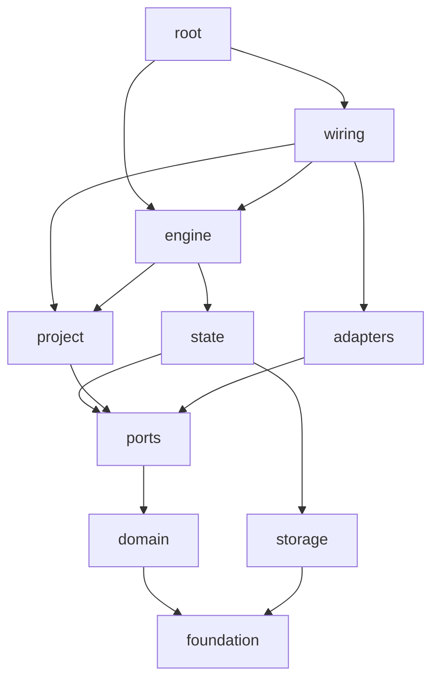

# Dependencies between modules

`src/factory` is layered.
`tests/test_layers.py` parses the imports of every module, lazy imports and `TYPE_CHECKING` imports included, and fails on any import cycle and on any import that breaks a rule below.
A module that is in no group fails it too, so a new module picks its group in the test.

## Groups

| Group | Modules | May import |
| --- | --- | --- |
| foundation | `clock`, `events`, `front_matter`, `git`, `names`, `run_agent`, `spawn`, `states`, `values` | foundation |
| domain | `ci_guard`, `deciders`, `fingerprint`, `gates`, `library_lookup`, `pipeline`, `pipeline_checks`, `throttle` | foundation |
| ports | `executor`, `sandbox`, `tracker`, `workbench` | foundation, domain |
| adapters | `claude_code`, `github`, `gitlab`, `sbx`, `tracker_cli` | foundation, domain, ports |
| project | `config` | foundation, domain, ports |
| storage | `commands`, `custody`, `journal` | foundation |
| state | `artifacts`, `metrics`, `projection`, `question`, `recovery`, `run_state`, `run_view`, `stats`, `timeline` | foundation, domain, ports, storage |
| engine | `attempt`, `ci_fix`, `ci_wait`, `clean`, `decision`, `inputs`, `issue_filing`, `isolation`, `landing`, `live`, `merge_window`, `operations`, `orchestrator`, `probes`, `run_agents`, `run_context`, `run_decision`, `run_start`, `sleep_block` | foundation, domain, ports, project, storage, state |
| wiring | `render`, `wiring` | foundation, domain, ports, adapters, project, storage, state, engine |
| root | `cli` | every group but adapters |

A group may always import its own modules.
Only `wiring`, the composition root, imports an adapter, and the adapter classes that live in `sandbox` and `workbench`.
`render`, the entry point of the renderer process, takes the Executor from the registry of `wiring`.
`wiring` is the top of the graph, and `cli` takes `Machine` from it.
`cli` is a package, and the test counts it as one module of the graph.
It holds `main` and the parser in `__init__`, one module per command (`check`, `run`, `status`, `stats`, `decide`,
`cancel`, `override`, `limits`, `resume`, `finish`, `clean`, `attach`) and `common` for what several commands share:
the host tool errors, the Tracker of a Spec, the ports of a Run, an orphaned Run taken from the Journal
and driving a Run to its end.
No module of the package imports more than half of `src/factory`.

## Graph

Every group also imports the foundation, and `wiring`, `root`, `engine`, `state` and `project` import the domain.
The arrows show the main direction only.

## The Orchestrator and its phases

`orchestrator` keeps the loop, the scheduling of Tickets, the Commands in the inbox and the dispatch to the modules of the engine.
Each phase of a Run lives in a module of its own, as `attempt` and `decision` do:

- `run_start`: base resolution, the Integration branch, the Library freeze, resuming an orphaned Run and reconciliation.
- `landing`: the PR text with the Describer, the push of the Integration branch and the PR through `PullRequests`.
- `run_agents`: the Workspace, Sandbox and branch of a Run-level agent, the wait for its slot, the start event of its Attempts and the clean-up after it, which `landing` and `ci_fix` share.
- `ci_wait`: the wait for the CI of the PR and the Decision `ci_failed`.
- `ci_fix`: the Rounds of the CI fixer on red CI, which the Orchestrator builds and `ci_wait` starts, and which check the fix with the `ci_guard` and the Gates.
- `run_decision`: the Decision `infra_failure` and the owner's answers to the Decisions of the Run.
- `probes`: the Probes of Gates and their verdicts.
- `operations`: `sync` and `merge`, and the clean-up of merged and abandoned Tickets.
- `issue_filing`: the Operation `file_issues`, which files the issues a Stage reports and puts their numbers into the code.

None of them imports `orchestrator`, and each takes the Run's `RunContext` and `Ports` from `run_context`.
`Ports` bundles the Executor, Sandbox, Workbench and Clock a Run works through.
A `RunContext` is frozen: the Run's id, directory, Integration branch, Spec snapshot, Tracker, base commit and `RunMemory`.
`cli` builds it before the Orchestrator, with `RunContext.new` for a new Run and `RunContext.replayed` from the events of a Run that resumes or finishes.
No phase writes a field of the Orchestrator.
What a phase learns goes into an event, and `RunMemory` keeps it: the PR, the pushed commit, how the CI wait ended and an owner's `abort`.
`Lander.land` returns the commands that finish a failed landing by hand.
Only the modules that run an Attempt import `attempt`, for `Attempts`: `orchestrator`, `run_start` and `run_agents`, through which `landing` and `ci_fix` run theirs.
The helpers that phases share live apart from it:

- `live` holds `Ended`, how an Attempt ended for its node, and `attempt_key`, the key of a Ticket's Attempt in its events.
- `inputs` holds `resolve_input`, the Brief entries of an input, and `schema_errors`, the check of an output against the Role's schema.
- `isolation` holds `Isolation`, which reaps a Ticket's Sandbox, counts its lost Sandboxes against `sandbox_retries` and removes a Sandbox, Workspace and branch with `CleanupEvents`.
  `Attempts` builds it, and `probes`, `operations` and `run_agents` use it.
- `run_decision` holds `gave_back`, what the Run's Decision gives back of the Attempts in the row of failures.

Besides that, `run_start` imports `landing` for the remote a Run lands through and `merge_window`, and `run_decision` imports `ci_wait` for the outcomes of `ci_failed` and `decision` for checking an answer.

## What the layers keep apart

- The domain model (`pipeline`, `throttle`, `fingerprint`, `library_lookup`) imports no port.
  The ports import it: `executor` uses `AgentSettings` from `pipeline` and `WindowUsage` from `throttle`.
- `AgentSettings` in `pipeline` is the one value type of what a Fresh agent runs with.
  `config` reads it, `Stage`, `Decider` and `RunAgentSpec` hold it, `AttemptRequest` carries it to the Executor, and `fingerprint_of` in `fingerprint` reads it into the Journal.
  `metrics` and `stats` take the keys of the fingerprint from `fingerprint`, so neither names a setting.
- `Read` lives in `pipeline`, and `library_lookup` imports `pipeline`, so the two no longer import each other.
- `fingerprint` takes the kit hash as a function, not the `Executor`.
- `config` checks the model names and efforts of the Pipeline through `Checks`, a protocol of its own that the Executor implements, so `wiring` hands it the Executors and builds nothing.
- `TERMINAL_NODES` lives in `states`.
- `journal` stores the payload of a brake, and `run_view` words it, so `journal` imports neither `pipeline` nor `throttle`.
- `run_state` keeps only the state the Journal replays, so it imports neither `executor`, `sandbox` nor `workbench`.
  `live` holds what the Orchestrator's process adds: `LiveTicket` with the running agent and Probe, the handles
  (`AttemptHandle`, `Process`, `AttemptTerminal`) and `Silence`.
- The Executor tells progress (`is_progress`) and renders its stream (`render_line`), so only `claude_code` reads a Claude event.
  `timeline` reads the turns and cost of an Attempt from the `usage` of `AttemptFinished`, not from the stream.
  `Silence` asks the Executor, and `render`, which runs as one process per Attempt, renders through the Executor
  named on its command line, so `workbench` passes the name of the Attempt's Executor on.
- `Failure` lives in `states`, so `run_state` needs no `executor` for it, and `marker` lives in `workbench`.
- `names` holds `integration_branch`, `ticket_branch`, `abandoned_ref` and `sandbox_name`, so `clean` imports neither `orchestrator` nor `attempt`.
- `run_agent` holds `RunAgent`, what every layer keys by the name of a Run-level agent: its slot, its events, its phase, its Sandbox names and what its Role must require.
  It sits in the foundation because `journal` releases the slot on the agent's `ends`, `run_view` shows its phase and `config` and `pipeline_checks` read its block, and the engine module `run_agents` runs it.

## Known exceptions

- `LocalSandbox` lives in `sandbox`, and `TerminalWorkbench` and `OrcaWorkbench` live in `workbench`.
  They are adapters in modules of the ports group, so the group rules cannot see them.
  `ADAPTER_CLASSES` in `tests/test_layers.py` keeps them apart instead, and only `wiring` may import them.

A new exception is a rule to change here and in the test together.

## Open problems

`coupling.md` measures the coupling and cohesion behind these problems and sets the direction of the refactor.

The layer rules hold, and the import graph has no cycle.
These problems remain inside the rules.
Numbers are from `main` at the merge of #179.

### Phases call back into the Orchestrator

The phases import no `orchestrator`, but the Orchestrator hands them callables, most of them its own private methods:

| Phase | Callbacks |
| --- | --- |
| `Attempts` | `_beat`, and `RunDecisions.ask` as `ask_run` |
| `Probes` | `_leave` |
| `CiWait` | `_beat`, `_apply_commands` |
| `RunStart` | `_mounts`, `_lose_attempt` |
| `Decisions` | `view.ring` |

- The import graph shows no cycle, but control still runs phase -> Orchestrator -> phase.
- A reader of `probes` cannot tell what `leave` does without `orchestrator`.
- Direction: move each callback into the phase or module that owns its state, such as `_leave` and `_enter` into a module of Ticket moves that `probes` and `orchestrator` both use.

### Phase constructors repeat the same arguments

- `append`, `ports`, `git`, `attempts` and `context` come into most phases one by one.
- `RunStart` takes 13 arguments, `CiWaiter` 11 and `Lander` 9.
- Direction: bundle the per-Run tools that every phase takes into one value, next to `RunContext`.

### The Orchestrator is still the largest module of the engine

- `orchestrator` has 821 lines and imports 31 of the 60 modules of `src/factory`.
- About 180 lines handle the Commands of the inbox: `cancel`, `override`, `limits` and the owner's answers.
- Direction: move the handling of Commands into a phase module, as `run_decision` does for Decisions of the Run.

### Starting a Run is split between `cli` and `run_start`

- `cli/run.py` calls `resolve_base`, `freeze_library` and `new_run_id` of `run_start`, then builds `RunContext` and the Orchestrator.
- `cli/common.py` builds `Ports` of `run_context` itself.
- The rules allow it, but the CLI knows the order of the steps that start a Run.
- Direction: one entry in the engine that builds a new or replayed Run from the project, the Spec and the ports.

### `config` is the largest module

- `config` has 934 lines and imports 10 modules, six of them from the domain.
- It holds two loaders: `load_project` for the project file and `_PipelineLoader`, about 420 lines, for the Pipeline file.
- The domain imports come from `_PipelineLoader`, which reads Stages, Gates, Decisions, Operations and their models.
- Direction: move `_PipelineLoader` into a module of its own in the project group.
