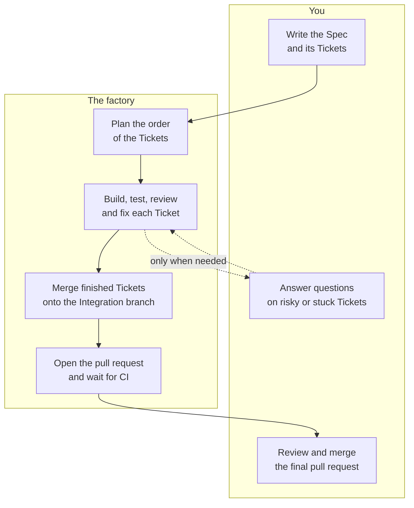
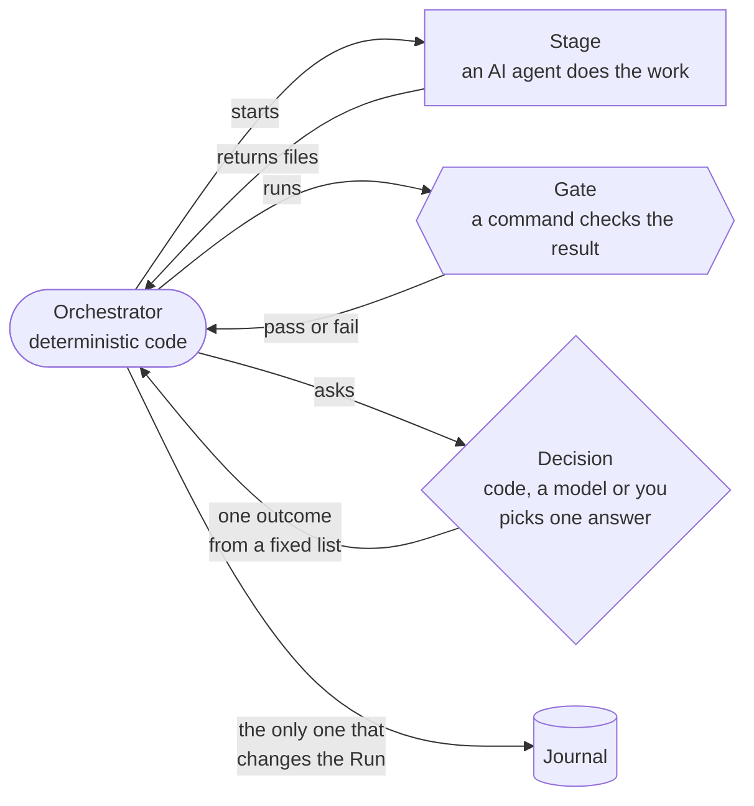

# 1. Why the factory exists

## The problem

A coding agent such as Claude Code can build one well-described change on its own.
A real feature is rarely one change.
It is a dozen pieces, some of which depend on others, and each piece has to be built, tested, reviewed, fixed and merged.

Doing this by hand means you become the agents' project manager.
You copy context from one session to the next, rerun the tests, read the review, ask for fixes, resolve merge conflicts and decide when a piece is good enough.
Most of that work is mechanical, and it eats the attention you wanted to save.

Handing the whole job to one long agent session does not work well either.
A long session fills its context and starts to forget.
It loses count of how many times it tried a fix.
It checks its own work, so its mistakes and its review share the same blind spots.
When it crashes, its progress is gone.

## What the factory does

The factory takes over the mechanical part and keeps you for the decisions.

1. You publish a **Spec** in your issue tracker and split it into **Tickets**, one per vertical slice of the feature.
2. You run `factory run <link to the Spec>`.
3. The factory builds every Ticket with fresh agents, each one doing one job, and checks the result with your project's own build, tests and linters.
4. Tickets that do not depend on each other run in parallel, each in its own copy of the repository and its own sandbox.
5. Every finished Ticket merges onto one **Integration branch**, and only code that passed the checks gets there.
6. The factory opens one pull request with a written summary and waits for your CI to go green.
7. You review the pull request and merge it.

## Goals

| Goal | How the factory pursues it |
| --- | --- |
| Code that works | Every change passes your build, tests and other checks before it merges, and again after it is combined with the other Tickets. The Run ends only when CI on the final pull request is green. |
| An independent review | The agent that reviews a change is not the agent that wrote it, and it starts with a clean context. |
| Predictable behavior | Plain code drives the process, not an AI. Round limits, model choice and routing live in a config file, not in a prompt the model may ignore. |
| Speed | Independent Tickets run at the same time. |
| Survives crashes | Every event of a Run goes into a journal on disk. A Run that crashed resumes where it stopped. |
| Your attention only where it matters | The factory asks you only about risky changes and Tickets it cannot finish. Everything else it settles on its own. |
| Fits any project | The process is a YAML file you can change, assembled from a shared Library of agent roles. Your project supplies its own commands. |
| Safe to leave running | Agents run in sandboxes that reach only the AI API and the hosts you allow. Your GitHub access never enters a sandbox, and the factory never pushes to `main`. |

## The three ideas behind the design

### Code drives, models work

The **Orchestrator** is ordinary deterministic code.
It decides which Ticket runs next, counts retries, merges branches and records every event.
AI models do the creative work inside **Stages** and help with judgment calls inside **Decisions**, but a model never changes the state of a Run directly.
So a Run behaves the same way every time for the same answers, and it can be replayed from its journal after a crash.

### Every agent starts fresh

Each agent starts with an empty context and a short **Brief**, a list of pointers to exactly the files its job needs.
An implementer sees the Spec and its Ticket.
A fixer also sees what failed.
A reviewer sees the change and the criteria, not the implementer's reasoning.
Knowledge passes from one agent to the next only through files the factory keeps, never through a shared conversation.

### Checks are facts, judgments are Decisions

A **Gate** runs a command, such as your tests, and passes or fails.
No model is involved, so a Gate cannot be talked into a pass.
Anything that needs judgment, such as "are these review findings worth fixing?", is a **Decision** with a fixed list of possible answers.
The config shows which answers come from code, which from a model and which from you.

## What the factory does not do

- It does not write your Spec or cut it into Tickets.
  You decide what to build and in which slices.
- It does not merge into your main branch.
  You merge the final pull request.
- It does not replace your CI.
  It runs the same commands as CI inside its sandboxes, and then waits for your real CI anyway, because a different machine can still find a failure.
- It does not read edits you make in the tracker after a Run starts.
  You steer a running Run through `factory` commands.

## Status

The factory is early and experimental.
It builds itself, and its interfaces still change.
Today it runs on macOS with Claude Code, Docker Sandboxes and GitHub or GitLab.
