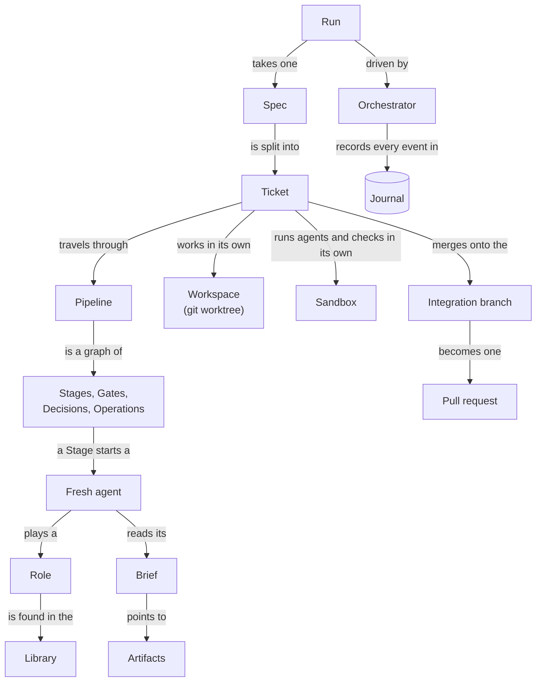

# 2. Glossary

The factory uses a small set of words, each with one exact meaning.
They are capitalized in these docs, so "Stage" always means the factory's Stage and never a step in general.
The precise engine-level definitions live in [`CONTEXT.md`](../../CONTEXT.md).

## How the terms fit together

## The work

| Term | Meaning | Example |
| --- | --- | --- |
| **Spec** | The description of a whole feature or product, published as an issue in your tracker. | Issue #120 "Add CSV export" |
| **Ticket** | One vertical slice of a Spec, published as a sub-issue of it. It goes through the Pipeline on its own. | Sub-issue #121 "Export the orders table as CSV" |
| **Blocked-by link** | An order between Tickets. A Ticket starts only after the Tickets that block it have merged. | #123 is blocked by #121 |
| **Frontier** | The Tickets that are open and no longer blocked. The factory works on these. | #121 and #122 at the start of the Run |
| **Tracker** | The place the Spec and its Tickets come from, and where the Run posts questions and its pull request. | GitHub Issues, GitLab Issues, a local folder |
| **Target project** | The repository the factory builds in. | Your service's repository |
| **Integration branch** | The single branch where the finished Tickets of one Run are merged. It becomes the pull request. | `factory/20261030-101500-ab12` |
| **Release channel** | How your changes reach users. It tells the reviewer whether a change can be rolled back. | `redeploy` for a service, `shipped_binary` for an app |

## The process

| Term | Meaning | Example |
| --- | --- | --- |
| **Pipeline** | A YAML graph that says what happens to a Ticket and in which order. | `tdd-review`, the default |
| **Node** | One point in a Pipeline. There are four kinds, listed below. | |
| **Stage** | A node where a Fresh agent works on the Ticket. | `implement`, `fix`, `review` |
| **Gate** | A node that runs a command and passes or fails. No model is involved. | `build`, `tests`, `coverage` |
| **Probe** | The command a Gate runs inside the Ticket's Sandbox to produce a report. | `make test` |
| **Decision** | A node that picks one outcome from a fixed list. | `triage` picks `fix` or `accept` |
| **Decider** | Whoever makes a Decision: a function, a model or a human. | The `risk` function, an Opus agent, you |
| **Operation** | A node where the Orchestrator itself changes git branches. No agent works in it. | `sync`, `merge` |
| **Outcome** | The result of a node, which picks the next node. | `done`, `pass`, `fail`, `accept` |
| **Round** | One entry of a Ticket into a Stage. A Stage can limit its Rounds. | The third time a Ticket enters `fix` |
| **Attempt** | One run of an agent inside a Round. A crashed Attempt is retried with a new one. | |
| **Merge window** | The right of one Ticket at a time to combine with the Integration branch and merge onto it. | |

## The agents

| Term | Meaning | Example |
| --- | --- | --- |
| **Fresh agent** | An AI agent that starts with an empty context for one Attempt. | A new `claude` process |
| **Role** | The reusable job of an agent: its prompt, the shape of its output and its skills. Several Stages can share one Role. | `implementer`, `tdd-reviewer` |
| **Library** | All the Roles, prompts, output schemas, skills and Pipelines the factory can find by name. | |
| **Layer** | One source of the Library. There are three: `factory`, `user` and `project`. | `.factory/` in your repository is the `project` Layer |
| **Brief** | The list of pointers a Fresh agent gets at its start, holding only the inputs its Stage declares. | |
| **Artifact** | A file the Run keeps, such as an agent's output, a Gate's verdict or a Decision's outcome. It never changes once written. | |
| **Handoff** | The part of an implementer's output where it tells later agents what it did and what is left. | |
| **Agent kit** | The plugin, settings and instructions every Fresh agent gets in place of your personal Claude Code setup. | |
| **Describer** | The agent that writes the title and body of the final pull request. | |
| **Consilium** | A Decider where several agents vote. Planned, not yet available. | |

## The Run

| Term | Meaning | Example |
| --- | --- | --- |
| **Run** | One pass of a Spec through the factory, from `factory run` to a green pull request. | Run `20261030-101500-ab12` |
| **Orchestrator** | The deterministic program that drives a Run. It is the only thing that changes the Run's state. | The `factory run` process |
| **Journal** | The SQLite event log of all Runs on your machine. A crashed Run is rebuilt from it. | |
| **Command** | A request to change a running Run, such as answering a Decision. The Orchestrator accepts or rejects it. | `factory decide ...` |
| **Slot** | The right of one Attempt to use your AI subscription. Your machine has a fixed number of them, shared by all Runs. | 4 by default |
| **Throttle** | An optional brake that pauses new Attempts when the Run spends your subscription's usage window too fast. | |
| **Project file** | `factory.yaml` in your repository. It names the Pipeline and gives it your project's commands and settings. | |
| **Factory config** | `config.yaml` in the factory's home directory. It holds what all Runs on your machine share. | `slots: 4` |

## Isolation

| Term | Meaning | Example |
| --- | --- | --- |
| **Workspace** | The git worktree that belongs to one Ticket, on the Ticket's own branch. | `factory/<run-id>--121` |
| **Sandbox** | The isolated machine an agent and the Gates' Probes run in. One Sandbox per Ticket. | A Docker Sandboxes (`sbx`) microVM |
| **Workbench** | Where you watch the Workspaces and the agents' terminals. | A plain terminal, or the Orca IDE |
| **Cockpit** | An interactive agent session for watching and steering a Run. Planned. | |

## Outcomes at a glance

Every node kind has a closed set of outcomes, and each outcome must lead somewhere.

| Node | Outcomes |
| --- | --- |
| Stage | `done`, `failed` (the agent could not work), and `exhausted` (the Round limit is reached) |
| Gate | `pass`, `fail` |
| Decision | The list it declares, plus `escalate` when it cannot decide |
| Operation `sync` | `clean`, `conflict` |
| Operation `merge` | `merged` |
| End of the Pipeline | `done` (merged) or `abandoned` (given up) |

## Ticket and Run states

A Ticket is `queued` until it reaches the Frontier, `active` while it travels through the Pipeline, and then `merged` or `abandoned`.

A Run is `running` until it ends as one of these:

| State | Meaning |
| --- | --- |
| `done` | Every Ticket merged, the pull request is open and CI passed or you accepted its failure. |
| `partial` | Some Tickets were abandoned. The merged ones still land in a pull request. |
| `aborted` | You stopped the Run after a repeated infrastructure failure. |
| `orphaned` | The Run's process died or was stopped. `factory resume` continues it, and `factory finish` ends it. |
