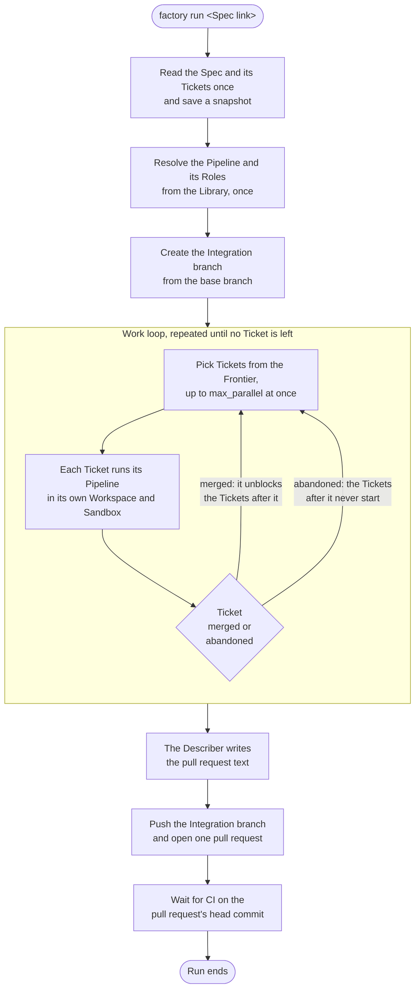
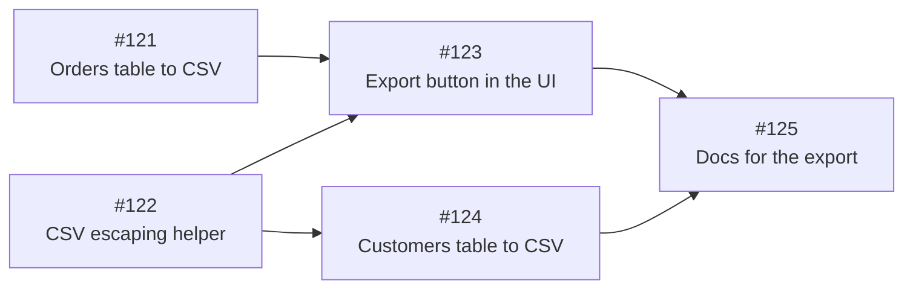
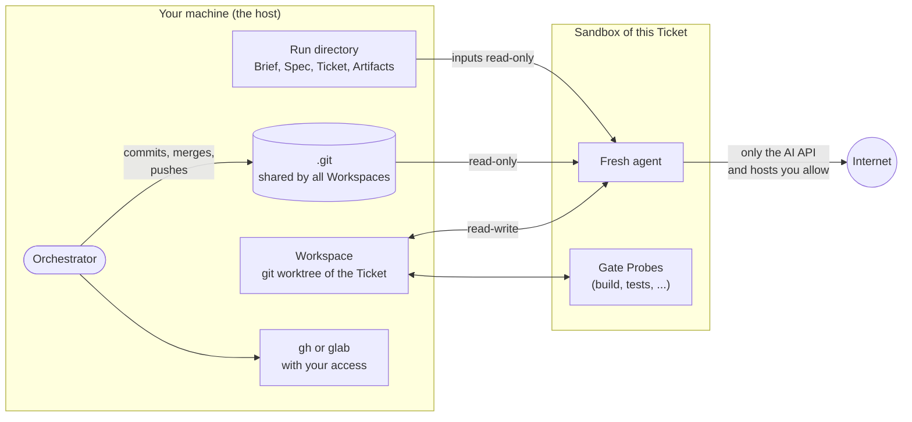
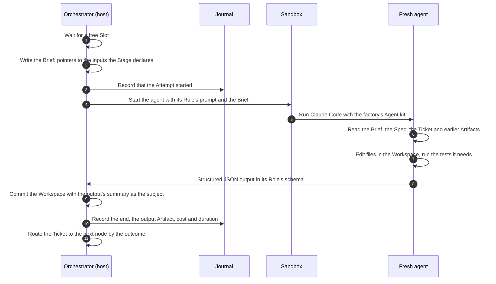
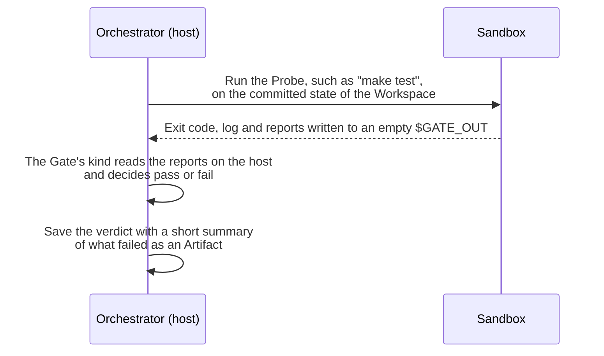
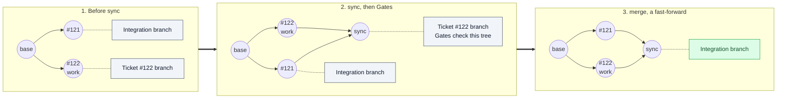
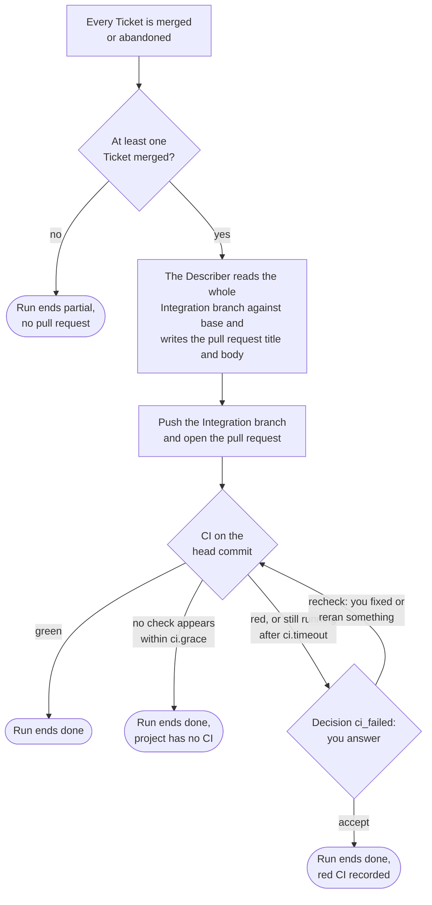
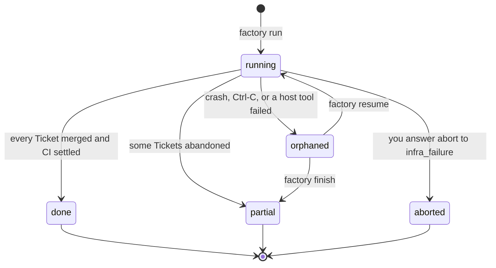

# 3. How a Run works

A Run is one pass of a Spec through the factory.
This page follows a Run from `factory run` to the green pull request.
It explains what happens to the Spec as a whole, then zooms into one Ticket, one agent and one merge.

## The Run from start to finish

Three things happen once, at the start, and never again during the Run:

- The factory reads the Spec and the Tickets from the Tracker and saves a snapshot.
  Edits you make in the Tracker later do not reach this Run.
- The factory resolves the Pipeline, the Roles, the prompts and the skills from the Library and keeps the final versions.
  A prompt you edit during the Run does not reach it either, so a resumed Run uses the same prompts as before.
- The factory creates the Integration branch `factory/<run-id>` from a fresh fetch of your base branch.

## Which Tickets run when

Tickets are sub-issues of the Spec, and blocked-by links order them.
The **Frontier** is every open Ticket whose blockers have all merged.
The Run works on up to `max_parallel` Tickets of the Frontier at once, as your project file sets.

Take a Spec with five Tickets:

An arrow means "must merge before".
With `max_parallel: 2` the Run unfolds like this, two Tickets at a time:

```mermaid
gantt
    dateFormat HH:mm
    axisFormat %H:%M
    section Lane 1
    #121 Orders table to CSV   :t1, 10:00, 40m
    #123 Export button         :t3, after t2, 35m
    #125 Docs                  :t5, after t3, 15m
    section Lane 2
    #122 CSV escaping helper   :t2, 10:00, 50m
    #124 Customers table       :t4, after t2, 30m
```

- At the start the Frontier is #121 and #122, so both start.
- #123 waits for both of its blockers, so it starts only when #122 merges.
- #124 needs only #122, so it starts at the same moment.
- #125 waits for both #123 and #124.

A Ticket unblocks others when it **merges**, not when its agents finish.
If a Ticket is abandoned, every Ticket that depends on it never starts, and the Run ends `partial`.

A Ticket closed in the Tracker before the Run counts as done, so the Run skips it and does not wait on it.

## Where a Ticket lives

Each Ticket gets two things of its own:

- A **Workspace**, a git worktree on its own branch `factory/<run-id>--<ticket>`, created from the current tip of the Integration branch.
- A **Sandbox**, an isolated microVM where its agents and its Gates' commands run.
  The Sandbox lives as long as the Ticket and is removed when the Ticket merges or is abandoned.

This split is deliberate:

- The agent edits files and reads git history, but it cannot commit, switch branches or touch other branches.
  The host commits the agent's work when its Stage ends.
- Your GitHub or GitLab access stays on the host.
  No agent can push, comment or open issues.
- The Sandbox reaches only the AI API and the hosts you list in `sandbox.egress`, such as your package registry.

## One Attempt of a Stage

When a Ticket enters a Stage, the Orchestrator starts a Fresh agent.
One run of that agent is an **Attempt**.

A few rules make each Attempt reproducible:

- The agent starts with an empty context.
  Everything it knows comes from the Brief.
- The Brief holds only the inputs the Stage declares in the Pipeline, such as `spec`, `ticket` or the output of an earlier Stage.
- The agent never sees your personal Claude Code setup.
  It gets the factory's Agent kit, plus your project's `.claude` settings unless the Stage asks for a `hermetic` profile.
- An Attempt that crashes, times out or goes silent for too long is thrown away.
  Its uncommitted edits are saved as `discarded.patch` for you to debug, the Workspace is reset, and a new Attempt starts from the same point.
- An Attempt lost because its Sandbox died, or because it ran out of memory, does not count against the Stage's `attempts`.

## How a Gate checks

A Gate runs your command and judges the result.

- The reports go into a fresh, empty directory outside the Workspace, so an agent cannot plant a fake green report.
- The verdict is made on the host by the factory's own code, so the agent cannot fake it either.
- The verdict's summary names the failing tests or lines, and the next fixing Stage gets it as its `cause`.

The [Gate kinds](05-customizing.md#gate-kinds) are listed in the customization guide.

## How a Ticket merges

Tickets merge onto the Integration branch one at a time.
Two Operations do the work, and the Gates run between them:

1. `sync` merges the current tip of the Integration branch into the Ticket's branch.
   Now the Ticket's branch holds the Ticket's work combined with every Ticket merged before it.
2. The Gates run again on that combined tree.
3. `merge` moves the Integration branch forward to the Ticket's branch tip.
   It is a fast-forward, so the Integration branch only ever points at trees that passed the Gates.

The **Merge window** makes this safe with many Tickets in flight.
Only one Ticket at a time may hold it, in the order they ask.
A Ticket holds it from `sync` through the Gates to `merge`, so the Integration branch cannot move under it.
If a Ticket needs an agent again, for example because a Gate failed after `sync`, it gives the window up and queues again later.

### When two Tickets touch the same lines

A text conflict sends the Ticket from `sync` to a Stage such as `resolve`.
The host leaves the conflict markers in the Workspace.
The agent edits the files to keep the work of both sides, and the host makes the merge commit once no markers are left.
The agent's Brief names the Tickets that merged in the meantime, so it can read what they changed and why.

A conflict in meaning, where both sides merge cleanly but the result breaks, shows up as a failed Gate after `sync`.
It goes through the usual fix loop.

## How a Run ends

When every Ticket has merged or been abandoned, the Run lands its work.

- A Run with an abandoned Ticket ends `partial` instead of `done` at each of these points, and its merged Tickets still land.
- The pull request body has a summary, the evidence that the change works, and a "Merge Danger" section with how reversible and how wide the change is.
- The factory appends `Closes #N` for each merged Ticket and lists the Tickets that did not land, with the reason.
- If the Describer fails, the pull request gets the factory's own plain text instead.
- If the push or the pull request fails, the Run prints the exact commands that finish the job by hand.
- The Run waits for CI because the Gates ran on a different machine than CI.
  A test that depends on timing or the operating system can pass in the Sandbox and fail in CI.
- Waiting for CI holds no Slot, so other Runs on your machine go on.

You review the pull request and merge it yourself.

## The lifecycle of a Run

A Run writes a heartbeat to the Journal.
A Run whose heartbeat is older than a minute counts as `orphaned`, and any other factory process marks it so and frees its Slots.
`factory resume` rebuilds the Run from the Journal and continues.
An agent that was running when the Orchestrator died is stopped, and its Stage starts over with a new Attempt.

## Where things are kept

| What | Where |
| --- | --- |
| The Journal of all Runs | A SQLite database in the factory home, `~/.local/share/software-factory` unless `FACTORY_HOME` says otherwise |
| Briefs, Artifacts, logs and transcripts of a Run | `$FACTORY_HOME/runs/<run-id>` |
| Workspaces | `$FACTORY_HOME/workspaces/<run-id>/<ticket>` |
| Ticket branches | `factory/<run-id>--<ticket>`, deleted after the Ticket merges |
| Work of an abandoned Ticket | `refs/factory/<run-id>/abandoned/<ticket>` |
| The Integration branch | `factory/<run-id>`, pushed to your remote at the end |

The factory writes only to branches under `factory/` and its own refs.
It never touches `main` or any other branch of yours.
