# 4. Pipelines

A Pipeline says what happens to a Ticket and in which order.
It is a YAML file that describes a graph of named nodes.
Each node has a kind, and each outcome of a node names the next node.

This page explains the four node kinds, how a Ticket moves between them, what each agent gets to read, and then walks through the default Pipeline `tdd-review`.

## The four node kinds

The diagrams in these docs draw each kind with its own shape.

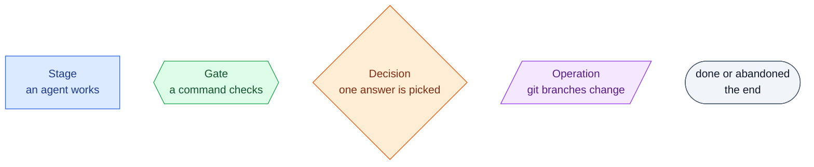

| Kind | Section in YAML | What happens | Outcomes |
| --- | --- | --- | --- |
| Stage | `stages` | A Fresh agent with a Role works on the Ticket. | `done`, `failed`, and `exhausted` when it has a Round limit |
| Gate | `gates` | A command runs in the Sandbox, and the factory judges its result. | `pass`, `fail` |
| Decision | `decisions` | A Decider picks one outcome from a fixed list. | The list it declares, plus `escalate` |
| Operation | `operations` | The Orchestrator itself merges git branches or acts on the Tracker. | `catch_up`: `clean`, `conflict`. `merge`: `merged`. `file_issues`: `filed`, `refused`, `failed`. `assign`, `label`, `comment`: `done`, and `failed` with `on_fail: escalate` |

Two names are reserved for the end of the road:

- `done` means the Ticket is finished.
  Only the `merge` Operation leads there in practice.
- `abandoned` means the factory gave up on the Ticket.
  Its work is saved under a ref for you to pick up.

## A minimal Pipeline

This Pipeline builds a Ticket, runs the tests, fixes failures, and merges.

```yaml
start: implement          # the first node of every Ticket
escalate_to: abandoned    # where anything unrouted goes

defaults:                 # settings every Stage gets unless it says otherwise
  model: sonnet
  timeout: 1h
  attempts: 2

stages:
  implement:
    role: implementer
    inputs: [spec, ticket]
    next: {done: tests}

  fix:
    role: implementer
    inputs: [spec, ticket, cause]
    rounds: {max: 3}
    next: {done: tests}

  resolve:
    role: reconciler
    inputs: [spec, ticket, cause]
    next: {done: catch_up}

gates:
  tests:
    kind: command
    with: {run: "make test", timeout: 20m}
    next: {pass: catch_up, fail: fix}

  combined_tests:
    kind: command
    with: {run: "make test", timeout: 20m}
    next: {pass: merge, fail: fix}

operations:
  catch_up:
    kind: catch_up
    next: {clean: combined_tests, conflict: resolve}

  merge:
    kind: merge
    next: {merged: done}
```

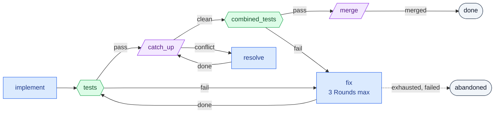

Read the YAML against the diagram:

- `next` maps each outcome to the next node.
- `tests` and `combined_tests` run the same command but are two nodes, because a node has one `next` and they lead to different places.
  YAML anchors (`&name` and `*name`) keep the copies' `with` from drifting apart.
- `fix` has no route for `exhausted` or `failed`, so those go to `escalate_to`, here `abandoned`.
- The tests run twice.
  The first time they judge the Ticket alone.
  The second time, after `catch_up`, they judge the Ticket combined with every Ticket merged before it, which is exactly the tree `merge` will publish.

## Routing rules

- Every outcome of every node must lead somewhere, either through `next` or through the Pipeline's `escalate_to`.
- An unmapped `failed`, `exhausted` or `escalate` goes to `escalate_to`.
- `escalate_to` is usually a human Decision, so anything the Pipeline cannot settle ends with you.
  It can also be `abandoned`, as in the minimal Pipeline above.
- A Pipeline with any Gate must declare `escalate_to`, because a Gate whose Sandbox keeps dying has no verdict to route by.
- When more than one Ticket runs at once, every path into `merge` must pass through `catch_up`.
  Otherwise the Integration branch could move and `merge` would no longer be a fast-forward.

`factory check` enforces all of these before a Run starts.

## Naming rule

An identifier inside a file is `snake_case`, and a name that stands for a file is `kebab-case`.

- `snake_case`: node names, Operation, Gate and Decider kinds, outcomes, keys of the project file and the Pipeline, `vars`
- `kebab-case`: names of Pipelines, Roles, prompts and schemas in the Library and in `.factory/`
- CLI flags and Tracker labels stay `kebab-case`, as their tools expect

A node name must match `[a-z][a-z0-9_]*`, and `factory check` names the node that does not.
The Operation kind `sync` is now `catch_up`, and `factory check` on a Pipeline that still says `sync` names the new kind.
A Run that started before the rename does not resume, so finish or abandon it before you upgrade the factory.

## Stages

A Stage starts one Fresh agent per Attempt.

| Field | Meaning | Example |
| --- | --- | --- |
| `role` | The Role from the Library: prompt, output schema and skills. | `implementer` |
| `inputs` | What goes into the agent's Brief. See [Inputs and the Brief](#inputs-and-the-brief). | `[spec, ticket, cause]` |
| `next` | Where each outcome leads. | `{done: build}` |
| `model` | The AI model, one the Stage's Executor accepts. `factory check` rejects any other. | `sonnet`, `opus` |
| `effort` | The reasoning effort, one the Stage's Executor accepts. `factory check` rejects any other. Without it, the Executor runs its own default. | `medium`, `high` |
| `rounds` | How many times the Ticket may enter this Stage, and where to go after that. | `{max: 5, then: ruling}` |
| `escalate` | Switch to a stronger model, and optionally a higher effort, from a given Round. | `{from_round: 4, model: opus, effort: high}` |
| `attempts` | How many agents to try within one Round before the Stage ends `failed`. | `2` |
| `timeout` | How long one Attempt may run. | `1h` |
| `stall` | How long an agent may go without a new message or tool result before it counts as stuck. | `30m` |
| `workspace` | `rw` lets the agent's edits be committed. `ro` throws any edit away and records a violation. | `ro` for a pure reviewer |
| `profile` | `project` lets the agent load your project's `.claude` settings and skills. `hermetic` gives it only the factory's kit. | `project` |

The Claude Code Executor, the default, accepts what `claude --model` accepts: the aliases `sonnet`, `opus`, `haiku` and `opusplan`, and full model IDs such as `claude-sonnet-4-5-20250929`, each with an optional `[1m]` suffix for the long context window.
It runs `sonnet` when a Pipeline names no model.
It accepts the efforts `low`, `medium`, `high`, `xhigh` and `max` and passes `--effort <level>` to `claude`; with no `effort` anywhere it passes no flag.
`factory check` tests every `model` and `effort` of the Pipeline, including `escalate.model`, `escalate.effort` and those of the Describer and of Deciders, and names the place of the first one that the Executor does not accept.

The `defaults` block of a Pipeline sets `model`, `effort`, `timeout`, `attempts`, `stall`, `workspace` and `profile` for every Stage at once.
It also sets `sandbox_retries`, how many times a Ticket's Sandbox may die before the Ticket escalates.

### Rounds and Attempts

Rounds and Attempts are two different counters, and the difference matters.

- A **Round** is one entry of a Ticket into a Stage.
  The `fix` Stage gets a new Round each time a Gate fails and sends the Ticket back.
  `rounds.max` limits how many times the agents get to try to converge.
- An **Attempt** is one agent inside a Round.
  If the agent crashes, times out or breaks its output format, the factory throws its work away and starts another Attempt in the same Round.
  `attempts` limits how many times the factory retries a broken agent.

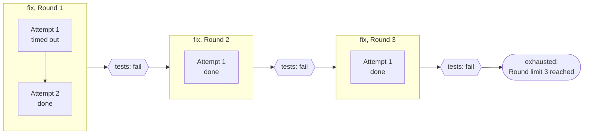

| What went wrong | Outcome | Meaning for you |
| --- | --- | --- |
| Every Attempt of a Round broke | `failed` | The agent could not work at all. Look at the infrastructure or the prompt. |
| The Round limit is reached | `exhausted` | The agents worked but did not converge. Look at the Ticket or the code. |
| The Sandbox died or ran out of memory | Neither | The factory retries without spending an Attempt or a Round. |

A route can give a Stage a fresh Round budget with `{to: fix, reset_rounds: [fix]}`.
Only a Decision may do that, because a reset inside a loop with no Decision would let the loop run forever.

## Gates

A Gate is a pair of a `kind` and its parameters in `with`.
The kind is code in the factory that knows a report format and decides pass or fail.
Your project supplies the command that produces the report.

```yaml
gates:
  tests:
    kind: tests                      # reads JUnit XML
    with:
      run: "make test JUNIT=$GATE_OUT/junit.xml"
      junit: junit.xml
      timeout: 30m
    next: {pass: coverage, fail: fix}

  coverage:
    kind: coverage
    from: tests                      # reads the report the tests Gate produced
    with: {format: lcov, report: lcov.info, min_changed: 80}
    next: {pass: review, fail: fix}
```

- `run` is the Probe, a shell command that runs in the Ticket's Sandbox on the committed state.
- A Probe writes its reports into `$GATE_OUT`, a fresh empty directory.
- `from` lets a Gate read another Gate's reports instead of running its own Probe, so the tests run once for both checks.
- `clean: true` removes ignored files, such as build caches, before the Probe runs.
- A Gate whose kind and `with` already passed on the same git tree in the same Ticket ends `pass` without a Probe, and `factory status --timeline` shows `reused <gate> probe <n>`.
  Only a `pass` is reused. `reuse: false` makes a Gate always run, for a command that depends on more than the tree, such as the network or the time.

The full list of kinds is in [Gate kinds](05-customizing.md#gate-kinds).

## Decisions

A Decision picks one outcome from a closed list.
The `decider` says who picks it.

```yaml
decisions:
  triage:
    decider: {kind: model, role: triager, model: opus}
    outcomes: [fix, accept]
    inputs: [spec, ticket, {stage: review}]
    next: {fix: fix, accept: risk}
```

| Decider kind | Who decides | Typical use |
| --- | --- | --- |
| `function` | Code in the factory, from the outputs of earlier Stages. Fast, free and repeatable. | `risk`: is this change risky enough to ask the owner? |
| `model` | A Fresh agent with a Role that must answer with one of the outcomes and its reasons. | `triage`: which review findings deserve a fix? |
| `human` | You. The Run shows a question card and waits. | `owner`: accept, rework or abandon a risky change |
| `consilium` | Several agents vote. Planned, not yet available. | |

Every Decision also has the implicit outcome `escalate`.
A model that keeps returning an invalid answer escalates, and so does a function that lacks the data it needs.

### What happens when a Decision asks you

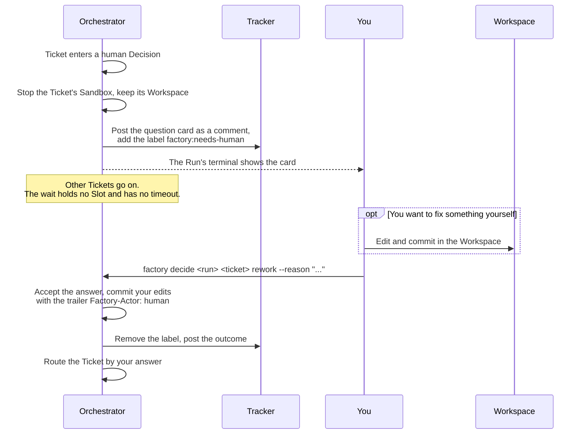

- An outcome that sends the Ticket back to work needs a `--reason`, because the next agent reads it as its `cause`.
- You can answer in the Run's terminal or with `factory decide` from any terminal.
  The first valid answer wins.
- If the Run's process died while waiting, your answer waits in the inbox and `factory resume` applies it.

## Operations

| Kind | What it does | Outcomes |
| --- | --- | --- |
| `catch_up` | Merges the current tip of the Integration branch into the Ticket's branch. On a conflict it leaves the markers in the Workspace. | `clean`, `conflict` |
| `merge` | Moves the Integration branch to the Ticket's tip as a fast-forward. | `merged` |
| `file_issues` | Files the issues that Stages report in the Tracker and puts their numbers into the code. | `filed`, `refused`, `failed` |
| `assign`, `label`, `comment` | Act on the Ticket in the Tracker. See [Tracker Operations](#tracker-operations). | `done`, and `failed` with `on_fail: escalate` |

A Ticket holds the [Merge window](03-how-a-run-works.md#how-a-ticket-merges) from `catch_up` until `merge`, as long as it passes only through Gates and Operations.
Entering a Stage or a Decision gives the window up.
`file_issues` and the Tracker Operations change no branch of the Run's, so they never ask for the window.

### Tracker Operations

`assign`, `label` and `comment` act through the Tracker's TicketBoard, in a Pipeline on the Ticket:

```yaml
start: implement
escalate_to: needs_human

operations:
  needs_human:
    kind: label
    with: {add: [needs-human]}
    next: {done: abandoned}
```

| Kind | `with` | What it does |
| --- | --- | --- |
| `assign` | | Adds the account the Tracker works as to the assignees, next to those already there. A Spec folder has no accounts and assigns nothing. |
| `label` | `add`, `remove`: lists of labels, at least one | Adds and takes off the labels. |
| `comment` | `text`, or in a Pipeline `from`, `field`, `each` and optionally `text` | Posts the static text, in which `${run}`, `${branch}`, `${spec}` and `${ticket}` stand for the Run's id, its Integration branch and the references of the Spec and the Ticket, or [the output of a Stage](#a-comment-from-a-stages-output). |

In a [Run graph](05-customizing.md#your-own-run-graph) they are nodes of the same kinds, which act on each Ticket the Run took, or on the Spec with `target: spec` in `with`.

`on_fail` next to `kind` says what a failure of the Tracker does, and each failure is journaled and shown in the terminal:

| `on_fail` | What happens |
| --- | --- |
| `warn`, the default | The Operation goes on, and the failure is the action's result. |
| `retry` | The action is tried again every 30 seconds with no limit, while the Run beats and takes the owner's Commands. Stop it with `factory cancel` of the Ticket in a Pipeline, or Ctrl-C at either level, and a Ticket waiting here keeps a Merge window it holds. |
| `escalate` | The node ends `failed`, which goes to its route in `next` or else to `escalate_to`. |

Each action journals its result per target as `TrackerActed` or `TrackerActionFailed`, so `factory resume` of a killed Run does only the actions the Journal lacks, and a Ticket that enters the Operation again acts again.
A Run killed between a call and its result does the call again on resume: `assign` and `label` change nothing the second time, and a `comment` can appear twice, as a Projection comment can.
A Pipeline or Run graph with a Tracker Operation fails `factory check` and the start of `factory run` on a Tracker without a TicketBoard.

#### A comment from a Stage's output

A `comment` in a Pipeline can take its text from a field of the latest output of a Stage:

```yaml
operations:
  post_findings:
    kind: comment
    with:
      from: review
      field: findings
      each: true
      text: "${item.id} at ${item.file}:${item.line}: ${item.summary}"
    on_fail: retry
    next: {done: triage}
```

| `with` | What it says |
| --- | --- |
| `from` | The Stage, which must have run on every path to the Operation |
| `field` | The field of its output, a text or a list, and a field left out or empty posts nothing |
| `each` | `true` posts one comment per item of a list, and without it the items go into one comment, separated by a blank line |
| `text` | What each item fills in, as `${item}` or `${item.name}` next to the references above, and without it each item is its own text; items that are objects need it |

`factory check` holds `field`, `each` and `${item.name}` against the schema of the Stage's Role, and a Run node has no `from`, because it has no Stage output.
Each comment journals its own `TrackerActed`, so `factory resume` posts only what the Journal lacks.
What an agent wrote is never read as a reference.

Such a comment ends in a mark no reader sees, with the Run and the Operation, by which a [Tracker input](#inputs-and-the-brief) with `posted_by` reads it back.

### `file_issues`

A Stage may find work that belongs in new issues of the Tracker, such as a suspicious behavior that a test pins, and the code it writes must point at those issues by number.
No agent in a Sandbox reaches the Tracker, so the agent writes a placeholder, and the host files the issues.

What the agent writes:

- In the code, a placeholder `#new:<key>` where the number goes, such as `// FINDING #new:ewma-empty-input: ...`.
  The `<key>` is lowercase letters, digits and `-`, and names one issue for the whole Ticket: a later Round or Stage that lists the same key again means the issue already filed, and the entry of the latest output wins.
  A key listed twice in one output fails the Operation.
- In its output, a list `issues` with one entry per key: `key`, `title`, `body` and `labels`.
  The Library ships this field as the schema fragment `issues`, which the schema of a Role extends with `x-extends: issues`.
  An entry without a placeholder is filed all the same, because an issue need not appear in code.

The Pipeline declares the Operation like `catch_up` and `merge`:

```yaml
operations:
  file_issues:
    kind: file_issues
    with: {from: [characterize, assertion-review], labels: [characterization], milestone: "C++ engine characterization coverage"}
    next: {filed: build, refused: fix, failed: escalation}
```

- `from` lists the Stages whose latest outputs it reads, and each must be a Stage of the Pipeline.
  `factory check` refuses any other name.
- `labels` and `milestone` go on every issue it files, besides the `labels` of the entry.
  An issue is filed in GitLab and GitHub through `glab` and `gh`, and the `LocalTracker` writes it to `issues/<number>.md` in the Spec's folder.
- Before it files an issue, it reads the open issues that carry the declared `labels`, and reuses the one whose title matches the entry's.
  This also catches the same finding reported by two Tickets of one Run.
- It replaces every placeholder in the Workspace with `#<number>` and commits the result on the Ticket's branch, so the Gates after it see the numbers.
- Each issue is journaled with its key before the replacement, and its body carries a hidden marker of the Run, the Ticket and the key.
  A Run that resumes after a crash finds the journal entry or the marker and reuses the issue, so it never files one twice.
- The text of an issue goes through the Tracker's `defuse`, so it never closes a Ticket of the Spec.
- A call to the Tracker that fails is tried again after 30 seconds, as the projection does, and after the third failure the outcome is `failed`.

The outcome is `refused`, with the cause that names the key and the file, when the Stages made a mistake that a fix Round can repair:

- a placeholder has no entry in `issues`, or a key is used twice in one output,
- a placeholder is left in the tree after the replacement, such as one in a file name.

`refused` leaves its `refused-N.json` as an artifact, like `conflict` of `catch_up`, so a Stage that lists `cause` among its inputs gets it, and `next: {refused: fix}` sends the Ticket there.
A `refused` that the Pipeline does not route escalates to `escalate_to`.

The outcome is `failed` when the Tracker keeps failing or git fails.
It always escalates, and it leaves the reason in `failed-N.json`.

The Run's final PR lists the issues it filed or reused per Ticket, and `factory status --timeline` shows the Operation with their numbers.

## Inputs and the Brief

Each Stage and each agent or human Decision declares its `inputs`.
The Brief of an agent holds pointers to exactly these inputs and nothing else, and a Tracker input holds the comments themselves.

| Input | What the agent gets |
| --- | --- |
| `spec` | The Spec's text, as it was when the Run started |
| `ticket` | The Ticket's text |
| `cause` | The Artifact of the node whose outcome led here, such as a Gate's verdict, a review's findings or a Decision's reasons |
| `{stage: review}` | The output of the latest Attempt of Stage `review` |
| `{stage: [implement, fix]}` | The latest output among those Stages |
| `{stage: fix, rounds: all}` | The outputs of every Round of `fix`, not only the last |
| `{gate: tests}` | The verdict of Gate `tests` |
| `{decision: triage}` | The outcome and reasons of Decision `triage` |
| `{tracker: ticket_comments}` | The comments of the Ticket that this Stage has not handled yet, by the owner and not the factory's own |
| `{tracker: pr_comments}` | The conversation and review threads of the Run's PR that this Stage has not handled yet, each with its `path`, `line` and `thread` where it has them |
| `{tracker: ticket_comments, authors: [owner, mona]}` | The same by these accounts, where `owner` stands for the owner |
| `{tracker: ticket_comments, posted_by: [post_findings]}` | The same, and also what these `comment` Operations posted from a Stage in this Run |
| `optional: true` | Leave the input out of the Brief if it does not exist, instead of failing the check |

Inputs are a deliberate design tool.
A reviewer that gets only `[spec, ticket]` judges the code against the requirements, without the implementer's story about why the code is right.
A fixer that gets `{stage: [implement, fix], rounds: all}` sees what every earlier Round did, so it does not undo their work.

`factory check` makes sure that a required input exists on every path that leads to its node.
A Pipeline where `ruling` could be reached before any review has run fails the check, not the Run.

A Stage has handled a comment once an Attempt whose Brief held it is done, which the Journal records as `handled` on its `AttemptFinished`.
So a retried Attempt gets the comment again, and the next entry into the Stage gets only those that came after.
A Tracker that cannot be read holds the Stage without spending an Attempt or a Round, and the Run warns and tries again.
Only a Stage takes a Tracker input, on a Tracker that serves Discussions: GitHub and GitLab do, and a Spec folder does not.
`factory check` refuses `pr_comments` on a node no path reaches after `open_pr`, so in a Ticket Pipeline, and `ticket_comments` on a Run Stage, which has no Ticket.
No Pipeline or Run graph can use `pr_comments` yet, because the only Run Stage is the Describer, which comes before `open_pr`.

## The default Pipeline: `tdd-review`

`tdd-review` ships with the factory and fits most projects.
Your project file names it with `pipeline: tdd-review` and fills in the commands.

### The overview

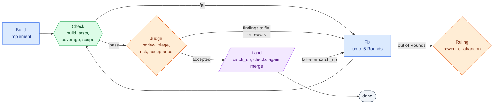

The Pipeline follows three principles:

- No agent judges and fixes the same code.
  The reviewer only reports, and a separate agent fixes.
- Code reaches review only when the build, tests, coverage and scope checks are green.
- A Ticket merges only after the checks pass again on the combined tree.

### Part 1: build and check

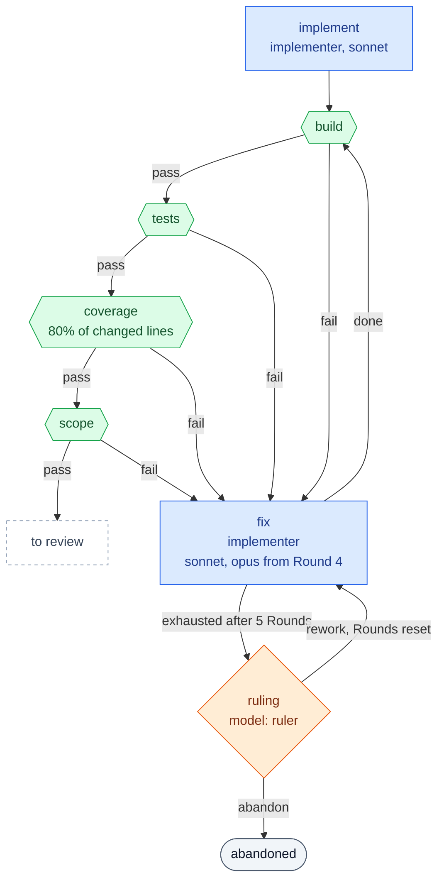

- `implement` builds the Ticket test-first with the skill `tdd`.
- `build`, `tests` and `coverage` run your project's commands from `vars`.
- `scope` runs a command that fails when the change reaches outside the Ticket, such as edits to CI files.
- Any failure sends the Ticket to `fix`, which gets the failed verdict as its `cause` and the `handoff` of every earlier Round.
- From Round 4 `fix` switches to Opus.
- After 5 Rounds an Opus agent rules whether one more try is worth it or the Ticket should be abandoned.

### Part 2: review and judgment

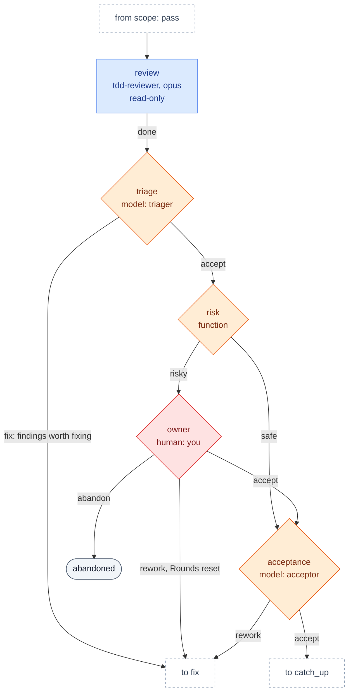

- `review` reads the change against the Spec and the Ticket on two axes, coding standards and spec fit.
  It runs read-only, so it reports and never edits.
- The reviewer also rates the Merge Danger of the change:
  - `door` is `two_way` if the change can be walked back after release and `one_way` if it cannot.
    It depends on your `release` channel, because a shipped app binary stays on users' machines.
  - `blast_radius` is `local`, `module`, `cross_module` or `external`.
- `triage` decides which findings are worth fixing.
  `fix` gets them as its `cause`.
- `risk` is plain code.
  It calls you only when `door` is `one_way` or `blast_radius` is `cross_module` or wider.
  Everything else goes on without you.
- `acceptance` makes a last check of the change against the Spec.

### Part 3: landing

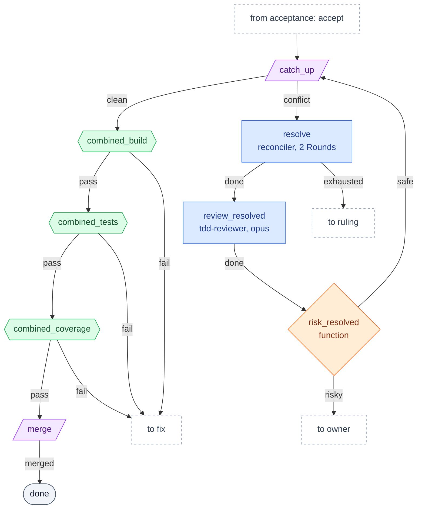

- `catch_up` brings in every Ticket merged so far.
- The `combined_` Gates check the combined tree, and a failure goes back to `fix` and through the whole loop again.
- A text conflict goes to `resolve`, whose result gets its own review and risk check before it returns to `catch_up`.
- Anything that no node settles, such as an agent that failed every Attempt, goes to `escalation`, a human Decision where you pick `rework` or `abandon`.

<details>
<summary>The whole <code>tdd-review</code> graph in one diagram</summary>

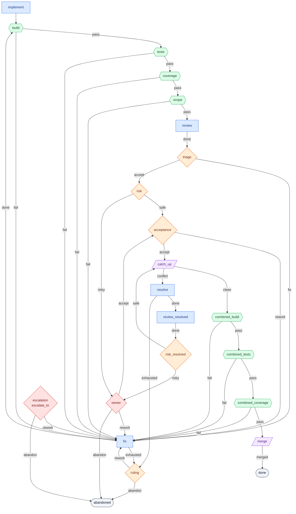

</details>

The YAML lives in [`src/factory/library/pipelines/tdd-review.yaml`](../../src/factory/library/pipelines/tdd-review.yaml), and its comments explain each choice.

## A review loop on the Tracker: `review-via-tracker`

`review-via-tracker` ships with the factory and runs the review where the owner reads it: on the Ticket.
Set `pipeline: review-via-tracker` in the project file, with `vars` `build`, `test` and `junit`, and `release`, which the reviewer reads, on a Tracker with a TicketBoard and Discussions, so GitHub or GitLab and no Spec folder.

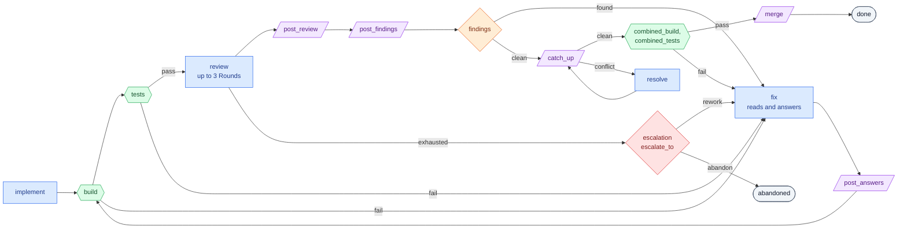

1. `review` reports and changes nothing, and `post_review` and `post_findings` post its summary and each finding as comments on the Ticket.
2. The function Decider `findings` sends a review without findings on to `catch_up`, and one with findings to `fix`.
3. `fix` reads the findings and anything you wrote on the Ticket through `{tracker: ticket_comments, posted_by: [post_findings]}`, fixes, and lists an answer for each comment by its `id`.
4. `post_answers` posts each answer as a reply: a comment that names the comment it answers, because the Tracker Operation `comment` posts on the Ticket and not in a thread.
5. The Gates run, and `review` looks again with its findings, the answers and your new comments, through `posted_by: [post_findings, post_answers]`.

So you can steer the loop by writing on the Ticket, because both Stages read your comments.

The loop stops at the `rounds` of `review`, 3 unless you set `overrides.stages.review.rounds`.
The Round past them gives `exhausted`, which goes to `escalate_to` as for any Stage, so you decide on `rework`, which starts the Rounds of `fix` and `review` over, or `abandon`.
The Operations have `on_fail: retry`, because a lost finding would never get fixed, so a Tracker that is down holds the Ticket until it comes back.
A conflict that `catch_up` finds goes to `resolve`, whose resolution passes the combined Gates but no second review.

The YAML lives in [`src/factory/library/pipelines/review-via-tracker.yaml`](../../src/factory/library/pipelines/review-via-tracker.yaml).

## A second example: `self`

The factory builds itself with a different Pipeline, `self`, from [`.factory/pipelines/self.yaml`](../../.factory/pipelines/self.yaml).
It shows how far a Pipeline can differ while using the same Roles.

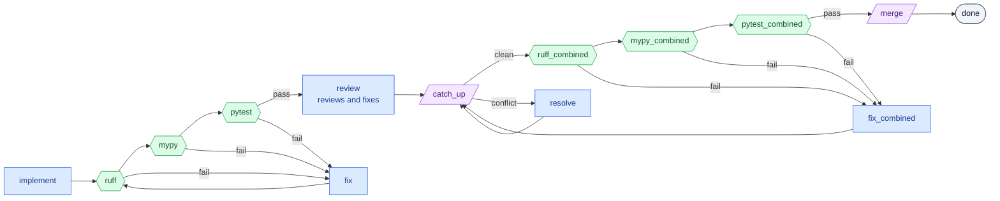

| | `tdd-review` | `self` |
| --- | --- | --- |
| Reviewer | Reports only, a separate `fix` acts on triaged findings | Reviews and fixes in one Attempt |
| Decisions | `triage`, `risk`, `acceptance`, `ruling`, human `owner` and `escalation` | None |
| Out of Rounds or failed | A model rules, then you decide | The Ticket is abandoned for you to pick up |
| Fix after `catch_up` | Back through the whole loop, review included | A separate `fix_combined` returns straight to `catch_up` |

## What `factory check` catches

`factory check` validates the project file and its Pipeline before any agent starts.
Among other things it rejects:

- an outcome with no route, and a node that does not exist
- a required input that is missing on some path to its node
- a `reset_rounds` inside a loop with no Decision in it
- Stages that send each other around in a loop on `exhausted`
- a path to `merge` that skips `catch_up` when Tickets run in parallel
- a Gate parameter with a typo, a missing threshold or a `run` without `$GATE_OUT` where a report is needed
- a Role whose output schema breaks the engine's contract, such as a model Decider whose `outcome` values are not the Decision's outcomes
- an unknown field anywhere in the files
- a node name that breaks the [naming rule](#naming-rule) or an Operation kind that is retired

`factory check` holds a [Run graph](05-customizing.md#your-own-run-graph) to the same route errors, and also rejects one whose start never reaches its one `tickets` node, one that can reach `describe` or `open_pr` before `tickets`, one that selects its Tickets twice or after `tickets`, and one with a loop.

`factory check --show <role>` prints the final prompt and output schema of a Role after every Library Layer is applied.
