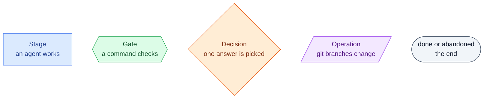
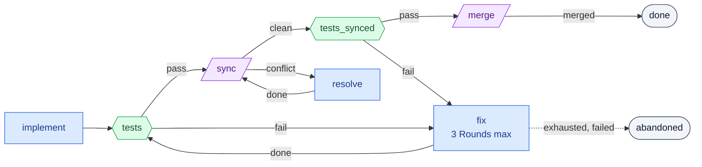
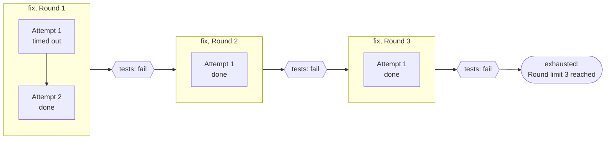
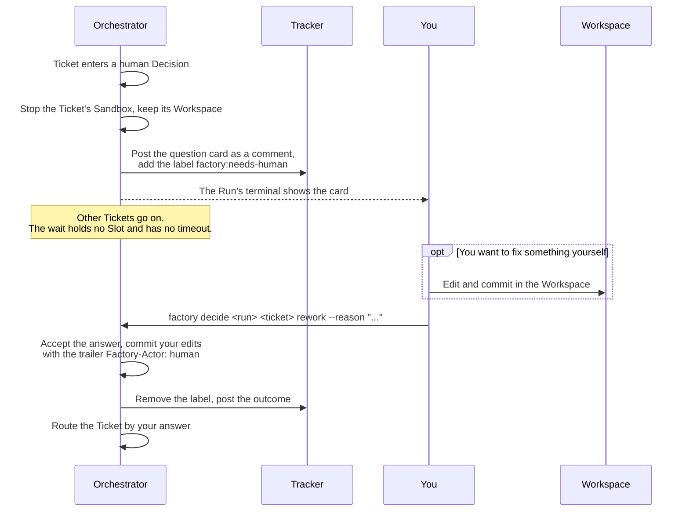
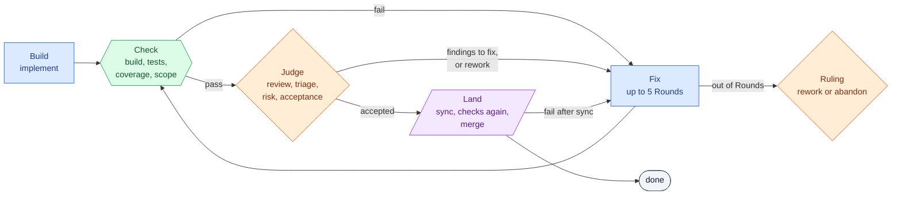
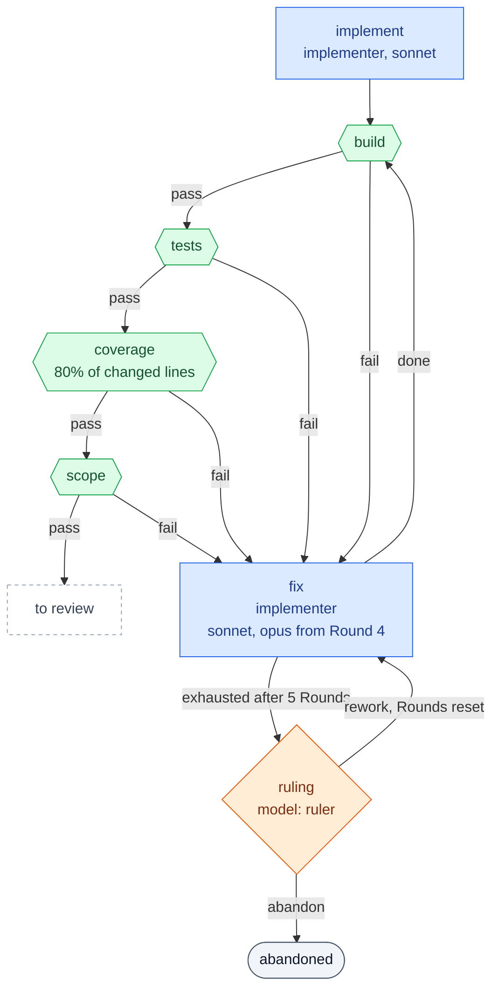
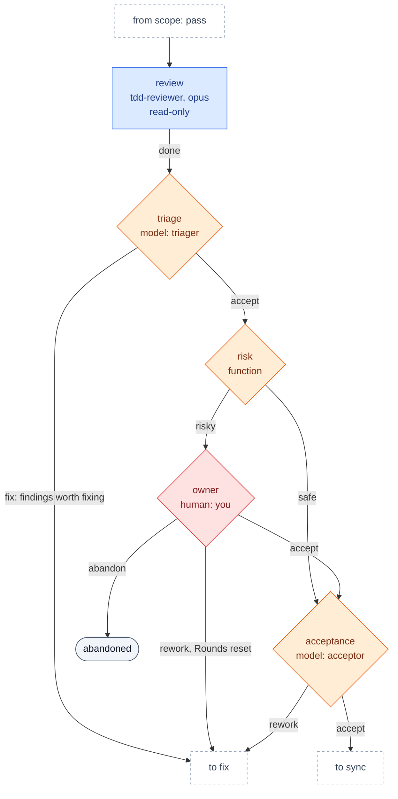
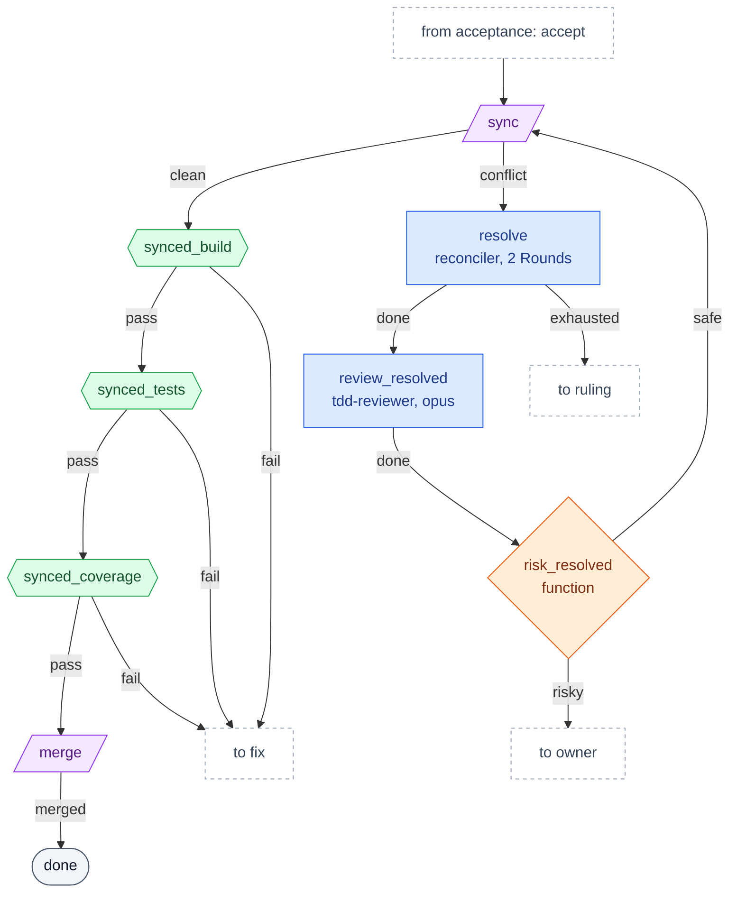
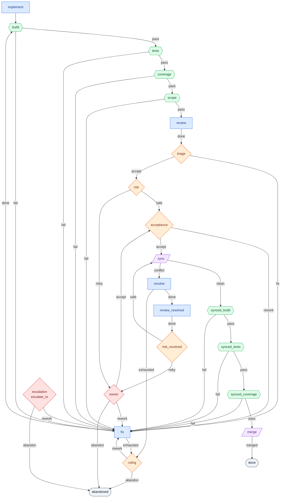
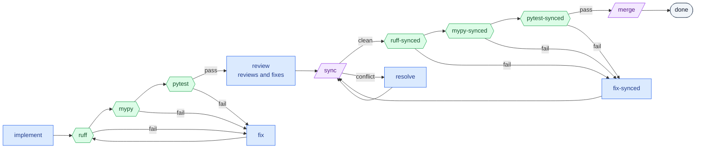

# 4. Pipelines

A Pipeline says what happens to a Ticket and in which order.
It is a YAML file that describes a graph of named nodes.
Each node has a kind, and each outcome of a node names the next node.

This page explains the four node kinds, how a Ticket moves between them, what each agent gets to read, and then walks through the default Pipeline `tdd-review`.

## The four node kinds

The diagrams in these docs draw each kind with its own shape.



| Kind | Section in YAML | What happens | Outcomes |
| --- | --- | --- | --- |
| Stage | `stages` | A Fresh agent with a Role works on the Ticket. | `done`, `failed`, and `exhausted` when it has a Round limit |
| Gate | `gates` | A command runs in the Sandbox, and the factory judges its result. | `pass`, `fail` |
| Decision | `decisions` | A Decider picks one outcome from a fixed list. | The list it declares, plus `escalate` |
| Operation | `operations` | The Orchestrator merges git branches itself. | `sync`: `clean`, `conflict`. `merge`: `merged` |

Two names are reserved for the end of the road:

- `done` means the Ticket is finished.
  Only the `merge` Operation leads there in practice.
- `abandoned` means the factory gave up on the Ticket.
  Its work is saved under a ref for you to pick up.

## A minimal Pipeline

This Pipeline builds a Ticket, runs the tests, fixes failures, and merges.

```yaml
start: implement          # the first node of every Ticket
escalate_to: abandoned    # where anything unrouted goes

defaults:                 # settings every Stage gets unless it says otherwise
  model: sonnet
  timeout: 1h
  attempts: 2

stages:
  implement:
    role: implementer
    inputs: [spec, ticket]
    next: {done: tests}

  fix:
    role: implementer
    inputs: [spec, ticket, cause]
    rounds: {max: 3}
    next: {done: tests}

  resolve:
    role: reconciler
    inputs: [spec, ticket, cause]
    next: {done: sync}

gates:
  tests:
    kind: command
    with: {run: "make test", timeout: 20m}
    next: {pass: sync, fail: fix}

  tests_synced:
    kind: command
    with: {run: "make test", timeout: 20m}
    next: {pass: merge, fail: fix}

operations:
  sync:
    kind: sync
    next: {clean: tests_synced, conflict: resolve}

  merge:
    kind: merge
    next: {merged: done}
```



Read the YAML against the diagram:

- `next` maps each outcome to the next node.
- `tests` and `tests_synced` run the same command but are two nodes, because a node has one `next` and they lead to different places.
  YAML anchors (`&name` and `*name`) keep the copies' `with` from drifting apart.
- `fix` has no route for `exhausted` or `failed`, so those go to `escalate_to`, here `abandoned`.
- The tests run twice.
  The first time they judge the Ticket alone.
  The second time, after `sync`, they judge the Ticket combined with every Ticket merged before it, which is exactly the tree `merge` will publish.

## Routing rules

- Every outcome of every node must lead somewhere, either through `next` or through the Pipeline's `escalate_to`.
- An unmapped `failed`, `exhausted` or `escalate` goes to `escalate_to`.
- `escalate_to` is usually a human Decision, so anything the Pipeline cannot settle ends with you.
  It can also be `abandoned`, as in the minimal Pipeline above.
- A Pipeline with any Gate must declare `escalate_to`, because a Gate whose Sandbox keeps dying has no verdict to route by.
- When more than one Ticket runs at once, every path into `merge` must pass through `sync`.
  Otherwise the Integration branch could move and `merge` would no longer be a fast-forward.

`factory check` enforces all of these before a Run starts.

## Stages

A Stage starts one Fresh agent per Attempt.

| Field | Meaning | Example |
| --- | --- | --- |
| `role` | The Role from the Library: prompt, output schema and skills. | `implementer` |
| `inputs` | What goes into the agent's Brief. See [Inputs and the Brief](#inputs-and-the-brief). | `[spec, ticket, cause]` |
| `next` | Where each outcome leads. | `{done: build}` |
| `model` | The AI model, one the Stage's Executor accepts. `factory check` rejects any other. | `sonnet`, `opus` |
| `rounds` | How many times the Ticket may enter this Stage, and where to go after that. | `{max: 5, then: ruling}` |
| `escalate` | Switch to a stronger model from a given Round. | `{from_round: 4, model: opus}` |
| `attempts` | How many agents to try within one Round before the Stage ends `failed`. | `2` |
| `timeout` | How long one Attempt may run. | `1h` |
| `stall` | How long an agent may go without a new message or tool result before it counts as stuck. | `30m` |
| `workspace` | `rw` lets the agent's edits be committed. `ro` throws any edit away and records a violation. | `ro` for a pure reviewer |
| `profile` | `project` lets the agent load your project's `.claude` settings and skills. `hermetic` gives it only the factory's kit. | `project` |

The Claude Code Executor, the default, accepts what `claude --model` accepts: the aliases `sonnet`, `opus`, `haiku` and `opusplan`, and full model IDs such as `claude-sonnet-4-5-20250929`, each with an optional `[1m]` suffix for the long context window.
It runs `sonnet` when a Pipeline names no model.
`factory check` tests every `model` of the Pipeline, including `escalate.model` and the models of the Describer and of Deciders, and names the place of the first one that the Executor does not accept.

The `defaults` block of a Pipeline sets `model`, `timeout`, `attempts`, `stall`, `workspace` and `profile` for every Stage at once.
It also sets `sandbox_retries`, how many times a Ticket's Sandbox may die before the Ticket escalates.

### Rounds and Attempts

Rounds and Attempts are two different counters, and the difference matters.

- A **Round** is one entry of a Ticket into a Stage.
  The `fix` Stage gets a new Round each time a Gate fails and sends the Ticket back.
  `rounds.max` limits how many times the agents get to try to converge.
- An **Attempt** is one agent inside a Round.
  If the agent crashes, times out or breaks its output format, the factory throws its work away and starts another Attempt in the same Round.
  `attempts` limits how many times the factory retries a broken agent.



| What went wrong | Outcome | Meaning for you |
| --- | --- | --- |
| Every Attempt of a Round broke | `failed` | The agent could not work at all. Look at the infrastructure or the prompt. |
| The Round limit is reached | `exhausted` | The agents worked but did not converge. Look at the Ticket or the code. |
| The Sandbox died or ran out of memory | Neither | The factory retries without spending an Attempt or a Round. |

A route can give a Stage a fresh Round budget with `{to: fix, reset_rounds: [fix]}`.
Only a Decision may do that, because a reset inside a loop with no Decision would let the loop run forever.

## Gates

A Gate is a pair of a `kind` and its parameters in `with`.
The kind is code in the factory that knows a report format and decides pass or fail.
Your project supplies the command that produces the report.

```yaml
gates:
  tests:
    kind: tests                      # reads JUnit XML
    with:
      run: "make test JUNIT=$GATE_OUT/junit.xml"
      junit: junit.xml
      timeout: 30m
    next: {pass: coverage, fail: fix}

  coverage:
    kind: coverage
    from: tests                      # reads the report the tests Gate produced
    with: {format: lcov, report: lcov.info, min_changed: 80}
    next: {pass: review, fail: fix}
```

- `run` is the Probe, a shell command that runs in the Ticket's Sandbox on the committed state.
- A Probe writes its reports into `$GATE_OUT`, a fresh empty directory.
- `from` lets a Gate read another Gate's reports instead of running its own Probe, so the tests run once for both checks.
- `clean: true` removes ignored files, such as build caches, before the Probe runs.

The full list of kinds is in [Gate kinds](05-customizing.md#gate-kinds).

## Decisions

A Decision picks one outcome from a closed list.
The `decider` says who picks it.

```yaml
decisions:
  triage:
    decider: {kind: model, role: triager, model: opus}
    outcomes: [fix, accept]
    inputs: [spec, ticket, {stage: review}]
    next: {fix: fix, accept: risk}
```

| Decider kind | Who decides | Typical use |
| --- | --- | --- |
| `function` | Code in the factory, from the outputs of earlier Stages. Fast, free and repeatable. | `risk`: is this change risky enough to ask the owner? |
| `model` | A Fresh agent with a Role that must answer with one of the outcomes and its reasons. | `triage`: which review findings deserve a fix? |
| `human` | You. The Run shows a question card and waits. | `owner`: accept, rework or abandon a risky change |
| `consilium` | Several agents vote. Planned, not yet available. | |

Every Decision also has the implicit outcome `escalate`.
A model that keeps returning an invalid answer escalates, and so does a function that lacks the data it needs.

### What happens when a Decision asks you



- An outcome that sends the Ticket back to work needs a `--reason`, because the next agent reads it as its `cause`.
- You can answer in the Run's terminal or with `factory decide` from any terminal.
  The first valid answer wins.
- If the Run's process died while waiting, your answer waits in the inbox and `factory resume` applies it.

## Operations

| Kind | What it does | Outcomes |
| --- | --- | --- |
| `sync` | Merges the current tip of the Integration branch into the Ticket's branch. On a conflict it leaves the markers in the Workspace. | `clean`, `conflict` |
| `merge` | Moves the Integration branch to the Ticket's tip as a fast-forward. | `merged` |

A Ticket holds the [Merge window](03-how-a-run-works.md#how-a-ticket-merges) from `sync` until `merge`, as long as it passes only through Gates and Operations.
Entering a Stage or a Decision gives the window up.

## Inputs and the Brief

Each Stage and each agent or human Decision declares its `inputs`.
The Brief of an agent holds pointers to exactly these inputs and nothing else.

| Input | What the agent gets |
| --- | --- |
| `spec` | The Spec's text, as it was when the Run started |
| `ticket` | The Ticket's text |
| `cause` | The Artifact of the node whose outcome led here, such as a Gate's verdict, a review's findings or a Decision's reasons |
| `{stage: review}` | The output of the latest Attempt of Stage `review` |
| `{stage: [implement, fix]}` | The latest output among those Stages |
| `{stage: fix, rounds: all}` | The outputs of every Round of `fix`, not only the last |
| `{gate: tests}` | The verdict of Gate `tests` |
| `{decision: triage}` | The outcome and reasons of Decision `triage` |
| `optional: true` | Leave the input out of the Brief if it does not exist, instead of failing the check |

Inputs are a deliberate design tool.
A reviewer that gets only `[spec, ticket]` judges the code against the requirements, without the implementer's story about why the code is right.
A fixer that gets `{stage: [implement, fix], rounds: all}` sees what every earlier Round did, so it does not undo their work.

`factory check` makes sure that a required input exists on every path that leads to its node.
A Pipeline where `ruling` could be reached before any review has run fails the check, not the Run.

## The default Pipeline: `tdd-review`

`tdd-review` ships with the factory and fits most projects.
Your project file names it with `pipeline: tdd-review` and fills in the commands.

### The overview



The Pipeline follows three principles:

- No agent judges and fixes the same code.
  The reviewer only reports, and a separate agent fixes.
- Code reaches review only when the build, tests, coverage and scope checks are green.
- A Ticket merges only after the checks pass again on the combined tree.

### Part 1: build and check



- `implement` builds the Ticket test-first with the skill `tdd`.
- `build`, `tests` and `coverage` run your project's commands from `vars`.
- `scope` runs a command that fails when the change reaches outside the Ticket, such as edits to CI files.
- Any failure sends the Ticket to `fix`, which gets the failed verdict as its `cause` and the `handoff` of every earlier Round.
- From Round 4 `fix` switches to Opus.
- After 5 Rounds an Opus agent rules whether one more try is worth it or the Ticket should be abandoned.

### Part 2: review and judgment



- `review` reads the change against the Spec and the Ticket on two axes, coding standards and spec fit.
  It runs read-only, so it reports and never edits.
- The reviewer also rates the Merge Danger of the change:
  - `door` is `two_way` if the change can be walked back after release and `one_way` if it cannot.
    It depends on your `release` channel, because a shipped app binary stays on users' machines.
  - `blast_radius` is `local`, `module`, `cross_module` or `external`.
- `triage` decides which findings are worth fixing.
  `fix` gets them as its `cause`.
- `risk` is plain code.
  It calls you only when `door` is `one_way` or `blast_radius` is `cross_module` or wider.
  Everything else goes on without you.
- `acceptance` makes a last check of the change against the Spec.

### Part 3: landing



- `sync` brings in every Ticket merged so far.
- The `synced_` Gates check the combined tree, and a failure goes back to `fix` and through the whole loop again.
- A text conflict goes to `resolve`, whose result gets its own review and risk check before it returns to `sync`.
- Anything that no node settles, such as an agent that failed every Attempt, goes to `escalation`, a human Decision where you pick `rework` or `abandon`.

<details>
<summary>The whole <code>tdd-review</code> graph in one diagram</summary>



</details>

The YAML lives in [`src/factory/library/pipelines/tdd-review.yaml`](../../src/factory/library/pipelines/tdd-review.yaml), and its comments explain each choice.

## A second example: `self`

The factory builds itself with a different Pipeline, `self`, from [`.factory/pipelines/self.yaml`](../../.factory/pipelines/self.yaml).
It shows how far a Pipeline can differ while using the same Roles.



| | `tdd-review` | `self` |
| --- | --- | --- |
| Reviewer | Reports only, a separate `fix` acts on triaged findings | Reviews and fixes in one Attempt |
| Decisions | `triage`, `risk`, `acceptance`, `ruling`, human `owner` and `escalation` | None |
| Out of Rounds or failed | A model rules, then you decide | The Ticket is abandoned for you to pick up |
| Fix after `sync` | Back through the whole loop, review included | A separate `fix-synced` returns straight to `sync` |

## What `factory check` catches

`factory check` validates the project file and its Pipeline before any agent starts.
Among other things it rejects:

- an outcome with no route, and a node that does not exist
- a required input that is missing on some path to its node
- a `reset_rounds` inside a loop with no Decision in it
- Stages that send each other around in a loop on `exhausted`
- a path to `merge` that skips `sync` when Tickets run in parallel
- a Gate parameter with a typo, a missing threshold or a `run` without `$GATE_OUT` where a report is needed
- a Role whose output schema breaks the engine's contract, such as a model Decider whose `outcome` values are not the Decision's outcomes
- an unknown field anywhere in the files

`factory check --show <role>` prints the final prompt and output schema of a Role after every Library Layer is applied.
