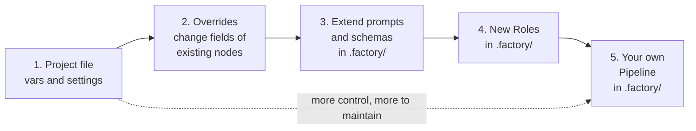
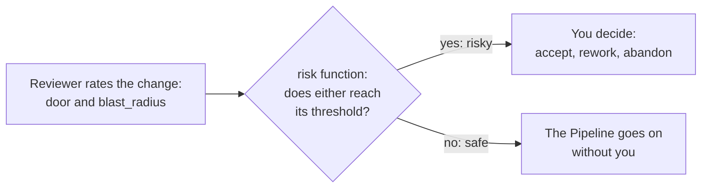
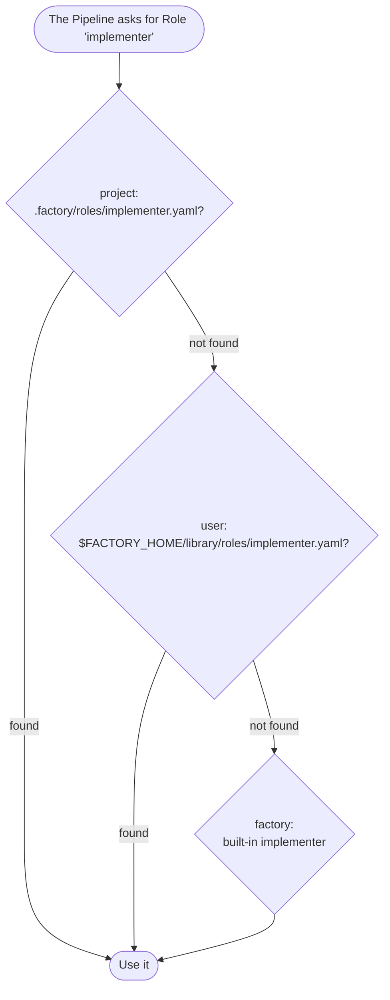
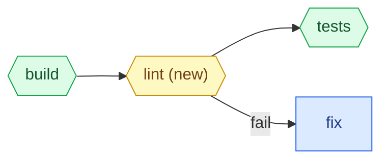

# 5. Adapting the factory to your project

The factory knows nothing about your project until you tell it.
You tell it through files at five levels, from a few lines of config to a Pipeline of your own.
Start at the lowest level that does the job, because each level up gives you more control and more to maintain.



| You want to | Level | Where |
| --- | --- | --- |
| Tell the factory how to build and test your project | 1 | `vars` in `factory.yaml` |
| Run more Tickets at once, give Sandboxes more memory, allow a package registry | 1 | `max_parallel`, `sandbox` in `factory.yaml` |
| Raise the coverage threshold, use a stronger model, allow more fix Rounds | 2 | `overrides` in `factory.yaml` |
| Change when the factory asks you about risky changes | 2 | `overrides` of the `risk` Decider |
| Teach the agents your project's conventions | 3 | `.factory/prompts/` |
| Make the reviewer report an extra field | 3 | `.factory/schemas/` |
| Give a Stage a job none of the shipped Roles does | 4 | `.factory/roles/` with its prompt and schema |
| Add or remove Gates, Stages or Decisions | 5 | `.factory/pipelines/` |

## Level 1: the project file

`factory.yaml` sits at the root of your repository.
Start from [`examples/tdd-review/factory.example.yaml`](../../examples/tdd-review/factory.example.yaml).

```yaml
pipeline: tdd-review      # the Pipeline, found by name in the Library
base: main                # the branch the Integration branch starts from and the PR targets
release: redeploy         # redeploy for a service, shipped_binary for an app or library users install
workbench: terminal       # terminal, or orca for the Orca IDE
# code_host: gitlab       # github or gitlab; set it when the git remote's host name does not tell, such as a self-hosted GitLab
max_parallel: 2           # Tickets at work at once

vars:                     # values the Pipeline uses as ${vars.name}
  build: make build
  test: make test JUNIT="$GATE_OUT/junit.xml" LCOV="$GATE_OUT/lcov.info"
  junit: junit.xml
  coverage_format: lcov
  coverage_report: lcov.info
  scope: "! git diff --name-only HEAD~1 | grep -q '^\\.github/'"

sandbox:
  kind: sbx
  cpus: 2
  memory: 4g
  egress: [registry.npmjs.org]
```

### Every field

Each of `executor`, `sandbox`, `workbench` and `code_host` picks a kind, by its name, such as `workbench: orca`, or by a block, such as `workbench: {kind: orca}`.
The two forms run the same.
The block holds the fields of its kind, such as `cpus` of the `sbx` Sandbox, and `factory check` refuses a field of another kind, such as `sandbox.template applies only to kind sbx`.

| Field | Meaning | Default |
| --- | --- | --- |
| `pipeline` | A Pipeline's name in the Library, or `{file: path/to/pipeline.yaml}` | Required |
| `run` | The name of a Run graph in the Library. See [your own Run graph](#your-own-run-graph). | `default` |
| `base` | The branch the Run starts from and opens its pull request into | Required |
| `release` | `redeploy` or `shipped_binary`. The reviewer reads it to judge whether a change can be walked back. | |
| `max_parallel` | How many Tickets of the Frontier work at once | |
| `vars` | Named values the Pipeline substitutes as `${vars.name}` | |
| `overrides` | Changes to fields of the nodes of the Pipeline and the Run graph. See [Level 2](#level-2-overrides). | |
| `sandbox.kind` | `sbx` for Docker Sandboxes. `local` runs agents on your machine without isolation and is meant for the factory's own tests. | `local` |
| `sandbox.cpus`, `sandbox.memory` | Resources of each Ticket's Sandbox | 4 CPUs, `8g` |
| `sandbox.egress` | Hosts the Sandbox may reach besides the ones the Executor needs (the AI API), such as your package registry | None |
| `sandbox.env` | Variables every command in the Sandbox carries, agents and Gates alike, such as `UV_PROJECT_ENVIRONMENT`. Names starting with `FACTORY_` are reserved. | None |
| `sandbox.template` | A Docker Sandboxes template image with your toolchain | The factory's pinned image |
| `caches` | Directory names whose ignored files a Stage may leave behind, such as `.venv` or `node_modules` | None |
| `workbench` | `terminal` or `orca` | `terminal` |
| `code_host` | `github` or `gitlab` | the one the git remote tells |
| `executor` | `claude-code`, the Executor a node of the Pipeline runs on unless it names its own `executor` | `claude-code` |
| `executors` | The settings of each Executor by its kind, `{<kind>: {<field>: ...}}`, for a Run whose nodes run on several Executors. For the kind of `executor` they lay over its block. `--set executors.<kind>.<field>=...` overrides one. | None |
| `throttle` | A brake on your subscription's usage and a dollar budget. See [Throttle](#throttle). | Off |
| `ci` | `{timeout: 60m, grace: 3m}` for the wait on CI, or `off` | On |
| `landing` | `single` opens one pull request for the Integration branch, `stack` opens one per merged Ticket, each into the branch of the one below (`factory/<run-id>--<k>-<slug>`). Merge a stack bottom up with merge commits only, and delete each branch after its merge. | `single` |
| `prevent_sleep` | Keep the computer from idle sleep while the Run is alive | `true` |

### Filling in `vars` for `tdd-review`

`tdd-review` needs six `vars`.

| Var | What it must do | Python example | Node example |
| --- | --- | --- | --- |
| `build` | Build the project, fail on errors | `uv sync --locked` | `npm ci && npm run build` |
| `test` | Run the tests and write a JUnit XML and a coverage report into `$GATE_OUT` | `uv run pytest --junitxml=$GATE_OUT/junit.xml --cov --cov-report=lcov:$GATE_OUT/lcov.info` | `JEST_JUNIT_OUTPUT_DIR=$GATE_OUT npx jest --ci --reporters=jest-junit --coverage --coverageReporters=lcov --coverageDirectory=$GATE_OUT` |
| `junit` | The JUnit file's name inside `$GATE_OUT` | `junit.xml` | `junit.xml` |
| `coverage_format` | `lcov`, `cobertura` or `jacoco` | `lcov` | `lcov` |
| `coverage_report` | The coverage file's name inside `$GATE_OUT` | `lcov.info` | `lcov.info` |
| `scope` | Fail when the change reaches outside what a Ticket may touch | `! git diff --name-only HEAD~1 \| grep -q '^\.github/'` | same |

Every command runs inside the Ticket's Sandbox, on the committed state of the Workspace.
Anything it downloads must come from a host in `sandbox.egress`.

### Caches

Each Stage's work is committed, and ignored files are not.
The host removes an ignored file a Stage leaves behind, because the Gates would judge a different tree than the one that merges, and `factory status` names the removed files.
If the change needed the file, the Gates fail on the clean tree and the Ticket goes to its fix Stage.
List your tools' cache directories in `caches`, so a Stage may leave files in them:

```yaml
caches: [.venv, __pycache__, .pytest_cache, node_modules, build]
```

### Machine-wide settings

`$FACTORY_HOME/config.yaml` holds what all Runs on your machine share.
`slots` is the number of agents that may run at once across every Run.
Next to it, the file may set any field of the project file as a default for every project on the machine.

```yaml
slots: 4
sandbox:
  kind: sbx
throttle:
  five_hour: {cap: 0.8}
```

Keep `slots` times `sandbox.cpus` below your machine's core count, and `slots` times `sandbox.memory` below its memory.
A `max_parallel` above `slots` gains nothing.

### Where a setting comes from

Each field resolves through four sources, and a later one wins:

1. the built-in default of the table above,
2. the machine's `$FACTORY_HOME/config.yaml`,
3. the project file,
4. the invocation, with `--set`.

A source merges into the blocks of the sources below it, so `sandbox.cpus` in the project file keeps the `sandbox.kind` of the factory config.
Any other value replaces the one below, and a value of `null` goes back to the built-in default.

`factory run` and `factory check` take `--set key=value`, as often as you like.
A dotted key reaches into a block, and the value is read as YAML:

```
factory run <spec> --set landing=stack --set ci.timeout=30m --set max_parallel=2
factory check --set sandbox.kind=sbx --set ci=off
```

A key the project file would reject stops the command with the message `factory check` gives for that key, before a Run starts.
`--no-prevent-sleep` is a shorthand of `--set prevent_sleep=false`.

A Run records every field as it resolved them when it started, besides the values of `sandbox.env`, which the Journal never holds.
`factory resume`, `factory finish` and `factory clean` go on with the recorded values, whatever the project file says by then, and take `sandbox.env` from the sources.
`factory status` names the fields whose recorded value differs from what the project file alone gives, such as `Settings unlike the project file: landing=stack`.
A Run started before the factory recorded its settings resumes from the sources as they are now.

### Throttle

The throttle keeps a Run from burning through your subscription.
It reads the usage of the windows your Executor reports, each named `<executor>.<window>`.
Claude Code reports `claude-code.five_hour` and `claude-code.seven_day`.
A bare `five_hour` or `seven_day` is the window of the project's `executor`, in the project file and in `factory limits`.

```yaml
throttle:
  five_hour: {cap: 0.8}      # start no new agent while the 5-hour window is above 80%
  seven_day: {pace: 0.5}     # spend at most 50% of the weekly window, spread evenly over its remaining time
```

`factory check` warns of a window your Executor never reports, because its brake would never hold the Run back, and of a brake or a budget on an Executor that no node of the Pipeline runs on.

While a window is above its `cap` or ahead of its `pace`, the Run starts no new Attempts on that window's Executor.
A Run whose Pipeline puts Stages on two Executors goes on with the Stages of the other one.
Running agents finish their work, and waiting spends no Rounds or Attempts.

The same block caps what a Run may cost in dollars, for the whole Run or for one Executor's share:

```yaml
throttle:
  budget_usd: 20                  # the whole Run
  claude-code: {budget_usd: 15}   # one Executor's share, which claude-code.budget_usd: 15 sets too
```

`--set throttle.budget_usd=20` sets it for one Run.
Only Attempts that ended count, so an agent that is still running can carry the Run past the cap.
At the cap the Run starts no new Attempts on any Executor, and once one waits it opens a Run Decision: raise the budget with `factory limits <run> --budget-usd 30`, and the Run goes on, or answer `factory decide <run> @run finish`.
`finish` stops the running agents, abandons the Tickets that did not merge and lands what merged.
A spent budget starts no CI fixer either, so red CI goes straight to the Decision `ci_failed`.
The Describer still writes the pull request of a Run past its budget, and its cost does not count against the budget.

## Level 2: overrides

`overrides` change fields of nodes the Pipeline already has.
They cannot add or remove nodes.

```yaml
overrides:
  stages:
    implement:
      model: opus                    # build with a stronger model
      effort: high                   # and think harder
    fix:
      rounds: {max: 8}               # merges into {max: 5, then: ruling}, so then stays
  gates:
    coverage:
      with: {min_changed: 90}        # merges into the rest of with
    combined_coverage:
      with: {min_changed: 90}
  decisions:
    risk:
      decider:
        with: {door: one_way, blast_radius: external}
    risk_resolved:
      decider:
        with: {door: one_way, blast_radius: external}
```

How overrides merge:

- Mappings merge key by key, so you change one threshold without repeating the rest.
- Lists replace the original whole, so `inputs: [spec, ticket]` is the new full list.
- In `stages` you may change any Stage field, including `role`, `next` and `inputs`.
- In `gates` you may change any Gate field.
- In `decisions` you may change only the `decider`.
- In `nodes` you may change any field of a Run node of the Run graph: `kind`, `with`, `on_fail` and `next`, and of a Run Stage its `role`, its settings and `next`.
- You may never change a Role's own fields, `prompt`, `schema` and `skills`, because other Stages share the Role.
  Pick another Role with `role:` instead.

### Recipes with overrides

| Goal | Override |
| --- | --- |
| Ask me about every change before it merges | `risk` and `risk_resolved` Deciders with `with: {door: two_way, blast_radius: local}`, the lowest thresholds |
| Ask me only about irreversible changes | Same Deciders with `with: {door: one_way, blast_radius: external}` |
| Give agents more time | `stages.implement.timeout: 2h` |
| Give up sooner on a stuck Ticket | `stages.fix.rounds: {max: 3}` |
| Switch `fix` to Opus earlier | `stages.fix.escalate: {from_round: 2}` |
| Drop the coverage check | `gates.tests.next: {pass: scope}` and `gates.combined_tests.next: {pass: merge}` |

The `risk` thresholds work like this.
`door` is `two_way` or `one_way`, and `blast_radius` grows from `local` to `module`, `cross_module` and `external`.
A change is risky when either rating reaches its threshold.



## The Library and its Layers

Every Role, prompt, output schema, skill and Pipeline has a name, and the factory finds it in the **Library**.
The Library has three **Layers**, each a directory with the same layout.

| Layer | Directory | Holds |
| --- | --- | --- |
| `project` | `.factory/` in your repository | What only this project needs |
| `user` | `$FACTORY_HOME/library/` | What all your projects share |
| `factory` | Ships with the factory | The default Roles and the Pipeline `tdd-review` |

Each Layer has the subdirectories `pipelines/`, `runs/`, `roles/`, `prompts/`, `schemas/` and `skills/`.

A name is looked up from the top Layer down, and the first match wins.



An item in a higher Layer either **replaces** or **extends** the item of the same name below it:

| Item | Replace | Extend |
| --- | --- | --- |
| Prompt (`.md`) | A file without `extends` | Front matter `extends: <name>` appends your text to the base prompt |
| Schema (`.json`) | A file without `x-extends` | Top-level `"x-extends": "<name>"` adds properties to the base schema |
| Role (`.yaml`) | Always replaced whole | |
| Skill (directory) | Always replaced whole | |
| Pipeline (`.yaml`) | Always replaced whole | |

A Run resolves the Library once at its start.
Edits you make while it runs reach only the next Run.

### The shipped Roles

| Role | Job | Used by `tdd-review` in |
| --- | --- | --- |
| `implementer` | Builds or fixes the Ticket test-first, and leaves a `handoff` for the next agent | `implement`, `fix` |
| `tdd-reviewer` | Reviews on two axes, standards and spec fit, and rates Merge Danger. Reports only. | `review`, `review_resolved` |
| `reviewer` | Reviews and fixes in one Attempt | Pipeline `self` |
| `reviewer-single` | Reviews along one axis | |
| `reconciler` | Resolves a text conflict after `catch_up` | `resolve` |
| `triager` | Decides which review findings deserve a fix | `triage` |
| `acceptor` | Accepts the change against the Spec or sends it back | `acceptance` |
| `ruler` | Rules on a Ticket that ran out of Rounds | `ruling` |
| `describer` | Writes the final pull request | The node `describe` of the default Run graph |
| `ci-fixer` | Fixes the Integration branch when CI on the final pull request is red | the Run Stage `ci_fix` of the Run graph |

A Role is a small YAML file that names a prompt, an output schema and skills:

```yaml
# src/factory/library/roles/implementer.yaml
prompt: implementer
schema: implementer
skills: [tdd]
reads:
  optional: {handoff: string, findings: array}
```

`reads` lists the output fields of other Stages that this Role expects in its Brief.
`factory check` makes sure every required field really arrives.

The Role of the Describer may also declare `body`, the headings and words its pull request body must hold:

```yaml
# src/factory/library/roles/describer.yaml
prompt: describer
schema: describer
skills: [pr]
body:
  headings: [Summary, Evidence, Merge Danger]
  words: [Door, Blast Radius]
```

The engine rejects a body that lacks one of them, and a Role without `body` may write any body.
A project with its own pull request template brings its own Describer Role with the headings of that template, or with none.

## Level 3: extend prompts and schemas

### Teach the agents your conventions

Create `.factory/prompts/implementer.md`:

```markdown
---
extends: implementer
---
## In this repository

- Read `docs/architecture.md` before you change a module.
- Every public function gets a docstring.
- Run only the tests next to the files you changed while you work, and the full suite once at the end.
```

The factory appends this text to the shipped `implementer` prompt.
Do the same for `tdd-reviewer`, `reconciler` or any other Role.

Prompts are static files.
They have no template variables, and the factory appends the path to the Brief itself.

### Make an agent report more

Create `.factory/schemas/tdd-reviewer.json`:

```json
{
  "x-extends": "tdd-reviewer",
  "type": "object",
  "required": ["migration_needed"],
  "properties": {
    "migration_needed": {
      "type": "boolean",
      "description": "Whether the change needs a database migration."
    }
  }
}
```

A schema extension can only add:

- properties merge by name
- `required` becomes the union of both lists
- a property that disagrees with the base is an error

To loosen a schema, replace it whole with a file that has no `x-extends`.

### See the result

```sh
factory check --show implementer
```

This prints the final prompt and schema of the Role after every Layer is applied.

## Level 4: new Roles

When no shipped Role fits, add one under `.factory/` with its own prompt and schema:

```text
.factory/
  roles/security-reviewer.yaml
  prompts/security-reviewer.md
  schemas/security-reviewer.json
```

```yaml
# .factory/roles/security-reviewer.yaml
prompt: security-reviewer
schema: security-reviewer
skills: [review]
```

A new Role can build on a shipped one, because `extends` may name any item, not only one of the same name:

```markdown
---
extends: tdd-reviewer
---
## Security

Also look for injection, secrets in code and unsafe deserialization, and report each as a finding.
```

```json
{
  "x-extends": "tdd-reviewer",
  "type": "object",
  "properties": {
    "cves": {"type": "array", "items": {"type": "string"}}
  }
}
```

Then point a Stage at it, through `overrides` or in your own Pipeline:

```yaml
overrides:
  stages:
    review:
      role: security-reviewer
```

The engine itself relies on only a few output fields:

- a Stage's `summary`, if present, is a string, and it becomes the subject of the Stage's commit
- a model Decider returns `outcome`, one of the Decision's outcomes, and may return `reasons`
- the Describer returns `title` and `body`

Every other field is an agreement between the Roles of one Pipeline.
For example, the `risk` function reads `door` and `blast_radius` from the reviewer's output, so a replacement reviewer in `tdd-review` must produce both with the same values.

## Level 5: your own Pipeline

Write your own Pipeline when you need to add or remove nodes.
Put it in `.factory/pipelines/<name>.yaml` and name it in the project file:

```yaml
pipeline: careful-review
```

Copy [`tdd-review.yaml`](../../src/factory/library/pipelines/tdd-review.yaml) as a starting point, and give it a new name, so it is clear the file is yours.
A file named `tdd-review.yaml` in `.factory/pipelines/` would replace the shipped one silently.

### Your own Run graph

The flow of a Run is a Run graph, in the format of a Pipeline, whose nodes have kinds of their own.
`factory library show run default` prints the shipped one and the Layer it came from:

```yaml
start: select
escalate_to: ended

nodes:
  select:
    kind: all
    next: {selected: build, empty: ended}

  build:
    kind: tickets
    with: {pipeline: '${vars.pipeline}'}
    next: {all_merged: describe, some_merged: describe, none_merged: ended}

  describe:
    role: describer
    next: {done: open_pr, failed: open_pr}

  open_pr:
    kind: open_pr
    next: {opened: ci, failed: ended}

  ci:
    kind: wait_ci
    next: {green: ended, absent: ended, red: ci_fix, timeout: ci_failed}

  ci_fix:
    role: ci-fixer
    workspace: integration
    rounds: {max: 2, then: ci_failed}
    next: {done: ci, failed: ci_fix}

  ci_failed:
    decider: {kind: human}
    outcomes:
      recheck: Wait for the CI of the PR's current head again, after you fixed or reran something
      accept: End the Run as it is, with the red CI recorded
    next: {recheck: ci, accept: ended}
```

- `select` produces the Tickets the Run takes, and kind `all` takes every open Ticket of the Spec, or those of `--tickets`.
- `tickets` runs the Ticket Pipeline it names over the Tickets, and `${vars.pipeline}` is what `pipeline:` in the project file says.
- `describe` is a Run Stage: the Describer writes the PR text, with the `defaults` of the Ticket Pipeline in what the node leaves out.
- `open_pr` pushes the Integration branch and opens the PR, with the Describer's text when `describe` ended `done` and the Tracker's own text otherwise, also in a graph without `describe`.
- `wait_ci` waits for the CI of the PR and ends `green`, `red`, `absent` or `timeout`, and holds no Slot.
- `ci_fix` is a Run Stage with `workspace: integration`: a Round commits its fix after a guard by diff, and the fix moves the Integration branch and is pushed when the walk leaves the Stage or the Run Gates it routes to.
- A node of a Gate kind, such as `kind: command`, is a Run Gate, which judges the fix in a Sandbox of the Run and routes `pass` and `fail` as a Gate of a Pipeline does. The default graph has none, because it cannot know your commands: `run: tdd-review` adds `build` and `tests` for a project on that Pipeline, and a project with others copies a graph with `factory library show run` and adds its own.
- `ci_failed` is a Decision that you answer with `factory decide <run> @run <outcome>`.
- Route `red` to `ended` to end the Run on red CI without a fixer.

Change a field with `overrides`, for example to end the Run when its PR is open:

```yaml
overrides:
  nodes:
    open_pr:
      next: {opened: ended}
```

Or to take only the Tickets marked for an agent, which carry every label of `label` and none of `without`:

```yaml
overrides:
  nodes:
    select:
      kind: filter
      with: {label: ready-for-agent, without: [blocked]}
```

The Run warns about each Ticket it leaves out, and the Tickets it leaves out get no status row and no line in the PR text.
A Ticket it takes that depends on one it left out, or on an open issue the Run cannot take, never starts: `factory status` and the PR text say what it waits for.
With no matching Ticket the Run ends `done` through `empty`, before any Workspace is made.
With `--tickets`, the filter looks only at those Tickets.
With kind `all`, a Ticket whose open blocker the Run does not take stops `factory run` before the Run starts.

Or give the Describer its own settings, where `role` names another Role:

```yaml
overrides:
  nodes:
    describe: {attempts: 2, timeout: 20m}
```

To change more, put a file in `.factory/runs/<name>.yaml` and name it with `run: <name>`.
The [Tracker Operations](04-pipelines.md#tracker-operations) `assign`, `label` and `comment` are node kinds too, so a Run assigns every Ticket it took before the first Attempt with a node in front of `build`:

```yaml
start: claim
escalate_to: ended

nodes:
  claim:
    kind: assign
    next: {done: build}
```

A file named `default.yaml` there replaces the shipped graph whole.
`factory check` rejects a graph with an outcome that has no route, with no `tickets` node its start reaches, with an `open_pr` or a `describe` a path reaches before `tickets`, with a `describe` after `open_pr`, with a second Run Stage, with a `select` node a path reaches after `tickets` or more than one of them, or with a loop.
A `describer:` block in a Pipeline file and a node of kind `land` are errors that name what replaced them, and a Run that froze either refuses to resume with that error.

### Example: add a lint Gate

Insert a Gate between `build` and `tests`, in both places the checks run:

```yaml
gates:
  build:
    kind: command
    with: {run: "${vars.build}", timeout: 30m}
    next: {pass: lint, fail: fix}          # was: tests

  lint:
    kind: command
    with: &lint {run: "${vars.lint}", timeout: 10m, match: '^\S+:\d+:\d+: '}
    next: {pass: tests, fail: fix}

  combined_build:
    kind: command
    with: {run: "${vars.build}", timeout: 30m}
    next: {pass: combined_lint, fail: fix}   # was: combined_tests

  combined_lint:
    kind: command
    with: *lint
    next: {pass: combined_tests, fail: fix}
```



`match` picks the lines of the log that the next `fix` sees as the failure summary.

### Example: always ask a human before merging

Add a human Decision between `acceptance` and `catch_up`:

```yaml
decisions:
  acceptance:
    # ...
    next: {accept: signoff, rework: fix}   # was: {accept: catch_up, ...}

  signoff:
    decider: {kind: human}
    outcomes: [merge, rework, abandon]
    inputs: [spec, ticket, {stage: review}]
    next: {merge: catch_up, rework: {to: fix, reset_rounds: [fix]}, abandon: abandoned}
```

The question card shows you the Ticket, the review and the outcomes.
You answer with `factory decide <run> <ticket> merge`.

### Checklist for a new Pipeline

- `start` names the first node, and `escalate_to` names where unsettled Tickets go.
- Node names are `snake_case` and the Pipeline's file name is `kebab-case`, as the [naming rule](04-pipelines.md#naming-rule) says.
- Every outcome of every node leads somewhere.
- Every path into `merge` passes through `catch_up` when `max_parallel` is above 1.
- Gates after `catch_up` run the same commands as before it, so the combined tree is checked.
- Every Stage declares the inputs its Role needs.
- `factory check` passes.

## Gate kinds

| Kind | Judges | Main `with` fields |
| --- | --- | --- |
| `command` | The exit code. The summary shows the log lines matching `match` and the tail of the log. | `run`, `timeout` (30m), `match`, `tail` (40 lines) |
| `tests` | A JUnit XML report. The summary lists the failed tests with their message and location. | `run` (must write into `$GATE_OUT`), `junit`, `timeout` |
| `coverage` | An `lcov`, `cobertura` or `jacoco` report against thresholds for the lines the Ticket changed and for the whole project | `format`, `report`, `min_changed`, `min_total` (at least one), and `run` or a Gate-level `from` |

Two more kinds are designed but not yet available:

- `diff-limits` would limit the number of changed files and lines and forbid paths.
- `document` would require a new document with given headings.

A timeout, a missing report, or a non-zero exit with a green report all count as `fail`.
