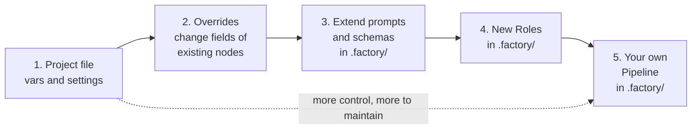
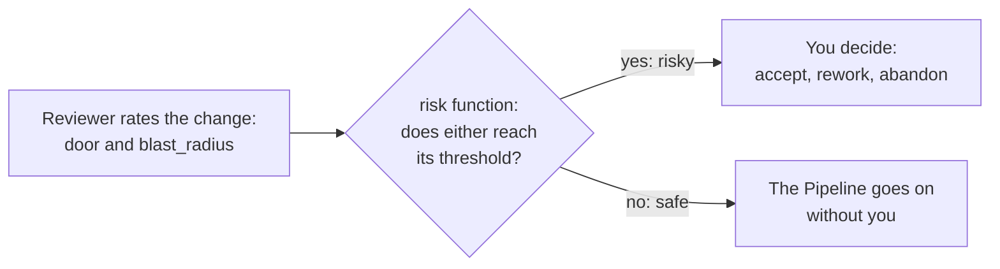
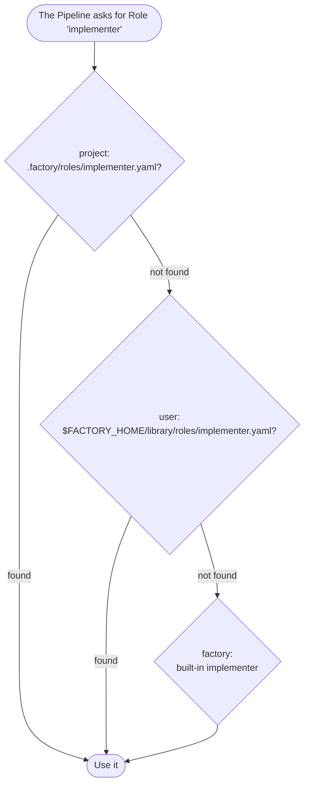
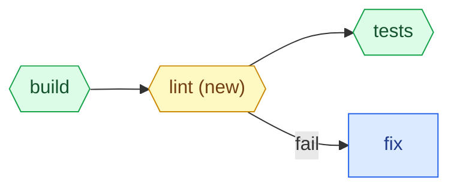

# 5. Adapting the factory to your project

The factory knows nothing about your project until you tell it.
You tell it through files at five levels, from a few lines of config to a Pipeline of your own.
Start at the lowest level that does the job, because each level up gives you more control and more to maintain.



| You want to | Level | Where |
| --- | --- | --- |
| Tell the factory how to build and test your project | 1 | `vars` in `factory.yaml` |
| Run more Tickets at once, give Sandboxes more memory, allow a package registry | 1 | `max_parallel`, `sandbox` in `factory.yaml` |
| Raise the coverage threshold, use a stronger model, allow more fix Rounds | 2 | `overrides` in `factory.yaml` |
| Change when the factory asks you about risky changes | 2 | `overrides` of the `risk` Decider |
| Teach the agents your project's conventions | 3 | `.factory/prompts/` |
| Make the reviewer report an extra field | 3 | `.factory/schemas/` |
| Give a Stage a job none of the shipped Roles does | 4 | `.factory/roles/` with its prompt and schema |
| Add or remove Gates, Stages or Decisions | 5 | `.factory/pipelines/` |

## Level 1: the project file

`factory.yaml` sits at the root of your repository.
Start from [`examples/tdd-review/factory.example.yaml`](../../examples/tdd-review/factory.example.yaml).

```yaml
pipeline: tdd-review      # the Pipeline, found by name in the Library
base: main                # the branch the Integration branch starts from and the PR targets
release: redeploy         # redeploy for a service, shipped_binary for an app or library users install
workbench: terminal       # terminal, or orca for the Orca IDE
# code_host: gitlab       # github or gitlab; set it when the git remote's host name does not tell, such as a self-hosted GitLab
max_parallel: 2           # Tickets at work at once

vars:                     # values the Pipeline uses as ${vars.name}
  build: make build
  test: make test JUNIT="$GATE_OUT/junit.xml" LCOV="$GATE_OUT/lcov.info"
  junit: junit.xml
  coverage_format: lcov
  coverage_report: lcov.info
  scope: "! git diff --name-only HEAD~1 | grep -q '^\\.github/'"

sandbox:
  kind: sbx
  cpus: 2
  memory: 4g
  egress: [registry.npmjs.org]
```

### Every field

| Field | Meaning | Default |
| --- | --- | --- |
| `pipeline` | A Pipeline's name in the Library, or `{file: path/to/pipeline.yaml}` | Required |
| `base` | The branch the Run starts from and opens its pull request into | Required |
| `release` | `redeploy` or `shipped_binary`. The reviewer reads it to judge whether a change can be walked back. | |
| `max_parallel` | How many Tickets of the Frontier work at once | |
| `vars` | Named values the Pipeline substitutes as `${vars.name}` | |
| `overrides` | Changes to fields of the Pipeline's nodes. See [Level 2](#level-2-overrides). | |
| `sandbox.kind` | `sbx` for Docker Sandboxes. `local` runs agents on your machine without isolation and is meant for the factory's own tests. | `local` |
| `sandbox.cpus`, `sandbox.memory` | Resources of each Ticket's Sandbox | 4 CPUs, `8g` |
| `sandbox.egress` | Hosts the Sandbox may reach besides the ones the Executor needs (the AI API), such as your package registry | None |
| `sandbox.env` | Variables every command in the Sandbox carries, agents and Gates alike, such as `UV_PROJECT_ENVIRONMENT`. Names starting with `FACTORY_` are reserved. | None |
| `sandbox.template` | A Docker Sandboxes template image with your toolchain | The factory's pinned image |
| `caches` | Directory names whose ignored files a Stage may leave behind, such as `.venv` or `node_modules` | None |
| `workbench` | `terminal` or `orca` | |
| `code_host` | `github` or `gitlab` | the one the git remote tells |
| `executor` | `claude-code` | `claude-code` |
| `throttle` | A brake on your subscription's usage. See [Throttle](#throttle). | Off |
| `ci` | `{timeout: 60m, grace: 3m}` for the wait on CI, or `off` | On |
| `prevent_sleep` | Keep the computer from idle sleep while the Run is alive | `true` |

### Filling in `vars` for `tdd-review`

`tdd-review` needs six `vars`.

| Var | What it must do | Python example | Node example |
| --- | --- | --- | --- |
| `build` | Build the project, fail on errors | `uv sync --locked` | `npm ci && npm run build` |
| `test` | Run the tests and write a JUnit XML and a coverage report into `$GATE_OUT` | `uv run pytest --junitxml=$GATE_OUT/junit.xml --cov --cov-report=lcov:$GATE_OUT/lcov.info` | `JEST_JUNIT_OUTPUT_DIR=$GATE_OUT npx jest --ci --reporters=jest-junit --coverage --coverageReporters=lcov --coverageDirectory=$GATE_OUT` |
| `junit` | The JUnit file's name inside `$GATE_OUT` | `junit.xml` | `junit.xml` |
| `coverage_format` | `lcov`, `cobertura` or `jacoco` | `lcov` | `lcov` |
| `coverage_report` | The coverage file's name inside `$GATE_OUT` | `lcov.info` | `lcov.info` |
| `scope` | Fail when the change reaches outside what a Ticket may touch | `! git diff --name-only HEAD~1 \| grep -q '^\.github/'` | same |

Every command runs inside the Ticket's Sandbox, on the committed state of the Workspace.
Anything it downloads must come from a host in `sandbox.egress`.

### Caches

Each Stage's work is committed, and ignored files are not.
A Stage that leaves an ignored file behind fails, because the Gates would judge a different tree than the one that merges.
List your tools' cache directories in `caches`, so a Stage may leave files in them:

```yaml
caches: [.venv, __pycache__, .pytest_cache, node_modules, build]
```

### Machine-wide settings

`$FACTORY_HOME/config.yaml` holds what all Runs on your machine share.
Today that is `slots`, the number of agents that may run at once across every Run.

```yaml
slots: 4
```

Keep `slots` times `sandbox.cpus` below your machine's core count, and `slots` times `sandbox.memory` below its memory.
A `max_parallel` above `slots` gains nothing.

### Throttle

The throttle keeps a Run from burning through your subscription.
It reads the usage of two windows, `five_hour` and `seven_day`.

```yaml
throttle:
  five_hour: {cap: 0.8}      # start no new agent while the 5-hour window is above 80%
  seven_day: {pace: 0.5}     # spend at most 50% of the weekly window, spread evenly over its remaining time
```

While a window is above its `cap` or ahead of its `pace`, the Run starts no new Attempts.
Running agents finish their work, and waiting spends no Rounds or Attempts.

## Level 2: overrides

`overrides` change fields of nodes the Pipeline already has.
They cannot add or remove nodes.

```yaml
overrides:
  stages:
    implement:
      model: opus                    # build with a stronger model
    fix:
      rounds: {max: 8}               # merges into {max: 5, then: ruling}, so then stays
  gates:
    coverage:
      with: {min_changed: 90}        # merges into the rest of with
    synced_coverage:
      with: {min_changed: 90}
  decisions:
    risk:
      decider:
        with: {door: one_way, blast_radius: external}
    risk_resolved:
      decider:
        with: {door: one_way, blast_radius: external}
```

How overrides merge:

- Mappings merge key by key, so you change one threshold without repeating the rest.
- Lists replace the original whole, so `inputs: [spec, ticket]` is the new full list.
- In `stages` you may change any Stage field, including `role`, `next` and `inputs`.
- In `gates` you may change any Gate field.
- In `decisions` you may change only the `decider`.
- You may never change a Role's own fields, `prompt`, `schema` and `skills`, because other Stages share the Role.
  Pick another Role with `role:` instead.

### Recipes with overrides

| Goal | Override |
| --- | --- |
| Ask me about every change before it merges | `risk` and `risk_resolved` Deciders with `with: {door: two_way, blast_radius: local}`, the lowest thresholds |
| Ask me only about irreversible changes | Same Deciders with `with: {door: one_way, blast_radius: external}` |
| Give agents more time | `stages.implement.timeout: 2h` |
| Give up sooner on a stuck Ticket | `stages.fix.rounds: {max: 3}` |
| Switch `fix` to Opus earlier | `stages.fix.escalate: {from_round: 2}` |
| Drop the coverage check | `gates.tests.next: {pass: scope}` and `gates.synced_tests.next: {pass: merge}` |

The `risk` thresholds work like this.
`door` is `two_way` or `one_way`, and `blast_radius` grows from `local` to `module`, `cross_module` and `external`.
A change is risky when either rating reaches its threshold.



## The Library and its Layers

Every Role, prompt, output schema, skill and Pipeline has a name, and the factory finds it in the **Library**.
The Library has three **Layers**, each a directory with the same layout.

| Layer | Directory | Holds |
| --- | --- | --- |
| `project` | `.factory/` in your repository | What only this project needs |
| `user` | `$FACTORY_HOME/library/` | What all your projects share |
| `factory` | Ships with the factory | The default Roles and the Pipeline `tdd-review` |

Each Layer has the subdirectories `pipelines/`, `roles/`, `prompts/`, `schemas/` and `skills/`.

A name is looked up from the top Layer down, and the first match wins.



An item in a higher Layer either **replaces** or **extends** the item of the same name below it:

| Item | Replace | Extend |
| --- | --- | --- |
| Prompt (`.md`) | A file without `extends` | Front matter `extends: <name>` appends your text to the base prompt |
| Schema (`.json`) | A file without `x-extends` | Top-level `"x-extends": "<name>"` adds properties to the base schema |
| Role (`.yaml`) | Always replaced whole | |
| Skill (directory) | Always replaced whole | |
| Pipeline (`.yaml`) | Always replaced whole | |

A Run resolves the Library once at its start.
Edits you make while it runs reach only the next Run.

### The shipped Roles

| Role | Job | Used by `tdd-review` in |
| --- | --- | --- |
| `implementer` | Builds or fixes the Ticket test-first, and leaves a `handoff` for the next agent | `implement`, `fix` |
| `tdd-reviewer` | Reviews on two axes, standards and spec fit, and rates Merge Danger. Reports only. | `review`, `review_resolved` |
| `reviewer` | Reviews and fixes in one Attempt | Pipeline `self` |
| `reviewer-single` | Reviews along one axis | |
| `reconciler` | Resolves a text conflict after `sync` | `resolve` |
| `triager` | Decides which review findings deserve a fix | `triage` |
| `acceptor` | Accepts the change against the Spec or sends it back | `acceptance` |
| `ruler` | Rules on a Ticket that ran out of Rounds | `ruling` |
| `describer` | Writes the final pull request | The end of every Run |

A Role is a small YAML file that names a prompt, an output schema and skills:

```yaml
# src/factory/library/roles/implementer.yaml
prompt: implementer
schema: implementer
skills: [tdd]
reads:
  optional: {handoff: string, findings: array}
```

`reads` lists the output fields of other Stages that this Role expects in its Brief.
`factory check` makes sure every required field really arrives.

The Role of the Describer may also declare `body`, the headings and words its pull request body must hold:

```yaml
# src/factory/library/roles/describer.yaml
prompt: describer
schema: describer
skills: [pr]
body:
  headings: [Summary, Evidence, Merge Danger]
  words: [Door, Blast Radius]
```

The engine rejects a body that lacks one of them, and a Role without `body` may write any body.
A project with its own pull request template brings its own Describer Role with the headings of that template, or with none.

## Level 3: extend prompts and schemas

### Teach the agents your conventions

Create `.factory/prompts/implementer.md`:

```markdown
---
extends: implementer
---
## In this repository

- Read `docs/architecture.md` before you change a module.
- Every public function gets a docstring.
- Run only the tests next to the files you changed while you work, and the full suite once at the end.
```

The factory appends this text to the shipped `implementer` prompt.
Do the same for `tdd-reviewer`, `reconciler` or any other Role.

Prompts are static files.
They have no template variables, and the factory appends the path to the Brief itself.

### Make an agent report more

Create `.factory/schemas/tdd-reviewer.json`:

```json
{
  "x-extends": "tdd-reviewer",
  "type": "object",
  "required": ["migration_needed"],
  "properties": {
    "migration_needed": {
      "type": "boolean",
      "description": "Whether the change needs a database migration."
    }
  }
}
```

A schema extension can only add:

- properties merge by name
- `required` becomes the union of both lists
- a property that disagrees with the base is an error

To loosen a schema, replace it whole with a file that has no `x-extends`.

### See the result

```sh
factory check --show implementer
```

This prints the final prompt and schema of the Role after every Layer is applied.

## Level 4: new Roles

When no shipped Role fits, add one under `.factory/` with its own prompt and schema:

```text
.factory/
  roles/security-reviewer.yaml
  prompts/security-reviewer.md
  schemas/security-reviewer.json
```

```yaml
# .factory/roles/security-reviewer.yaml
prompt: security-reviewer
schema: security-reviewer
skills: [review]
```

A new Role can build on a shipped one, because `extends` may name any item, not only one of the same name:

```markdown
---
extends: tdd-reviewer
---
## Security

Also look for injection, secrets in code and unsafe deserialization, and report each as a finding.
```

```json
{
  "x-extends": "tdd-reviewer",
  "type": "object",
  "properties": {
    "cves": {"type": "array", "items": {"type": "string"}}
  }
}
```

Then point a Stage at it, through `overrides` or in your own Pipeline:

```yaml
overrides:
  stages:
    review:
      role: security-reviewer
```

The engine itself relies on only a few output fields:

- a Stage's `summary`, if present, is a string, and it becomes the subject of the Stage's commit
- a model Decider returns `outcome`, one of the Decision's outcomes, and may return `reasons`
- the Describer returns `title` and `body`

Every other field is an agreement between the Roles of one Pipeline.
For example, the `risk` function reads `door` and `blast_radius` from the reviewer's output, so a replacement reviewer in `tdd-review` must produce both with the same values.

## Level 5: your own Pipeline

Write your own Pipeline when you need to add or remove nodes.
Put it in `.factory/pipelines/<name>.yaml` and name it in the project file:

```yaml
pipeline: careful-review
```

Copy [`tdd-review.yaml`](../../src/factory/library/pipelines/tdd-review.yaml) as a starting point, and give it a new name, so it is clear the file is yours.
A file named `tdd-review.yaml` in `.factory/pipelines/` would replace the shipped one silently.

### Example: add a lint Gate

Insert a Gate between `build` and `tests`, in both places the checks run:

```yaml
gates:
  build:
    kind: command
    with: {run: "${vars.build}", timeout: 30m}
    next: {pass: lint, fail: fix}          # was: tests

  lint:
    kind: command
    with: &lint {run: "${vars.lint}", timeout: 10m, match: '^\S+:\d+:\d+: '}
    next: {pass: tests, fail: fix}

  synced_build:
    kind: command
    with: {run: "${vars.build}", timeout: 30m}
    next: {pass: synced_lint, fail: fix}   # was: synced_tests

  synced_lint:
    kind: command
    with: *lint
    next: {pass: synced_tests, fail: fix}
```



`match` picks the lines of the log that the next `fix` sees as the failure summary.

### Example: always ask a human before merging

Add a human Decision between `acceptance` and `sync`:

```yaml
decisions:
  acceptance:
    # ...
    next: {accept: signoff, rework: fix}   # was: {accept: sync, ...}

  signoff:
    decider: {kind: human}
    outcomes: [merge, rework, abandon]
    inputs: [spec, ticket, {stage: review}]
    next: {merge: sync, rework: {to: fix, reset_rounds: [fix]}, abandon: abandoned}
```

The question card shows you the Ticket, the review and the outcomes.
You answer with `factory decide <run> <ticket> merge`.

### Checklist for a new Pipeline

- `start` names the first node, and `escalate_to` names where unsettled Tickets go.
- Every outcome of every node leads somewhere.
- Every path into `merge` passes through `sync` when `max_parallel` is above 1.
- Gates after `sync` run the same commands as before it, so the combined tree is checked.
- Every Stage declares the inputs its Role needs.
- `factory check` passes.

## Gate kinds

| Kind | Judges | Main `with` fields |
| --- | --- | --- |
| `command` | The exit code. The summary shows the log lines matching `match` and the tail of the log. | `run`, `timeout` (30m), `match`, `tail` (40 lines) |
| `tests` | A JUnit XML report. The summary lists the failed tests with their message and location. | `run` (must write into `$GATE_OUT`), `junit`, `timeout` |
| `coverage` | An `lcov`, `cobertura` or `jacoco` report against thresholds for the lines the Ticket changed and for the whole project | `format`, `report`, `min_changed`, `min_total` (at least one), and `run` or a Gate-level `from` |

Two more kinds are designed but not yet available:

- `diff-limits` would limit the number of changed files and lines and forbid paths.
- `document` would require a new document with given headings.

A timeout, a missing report, or a non-zero exit with a green report all count as `fail`.
