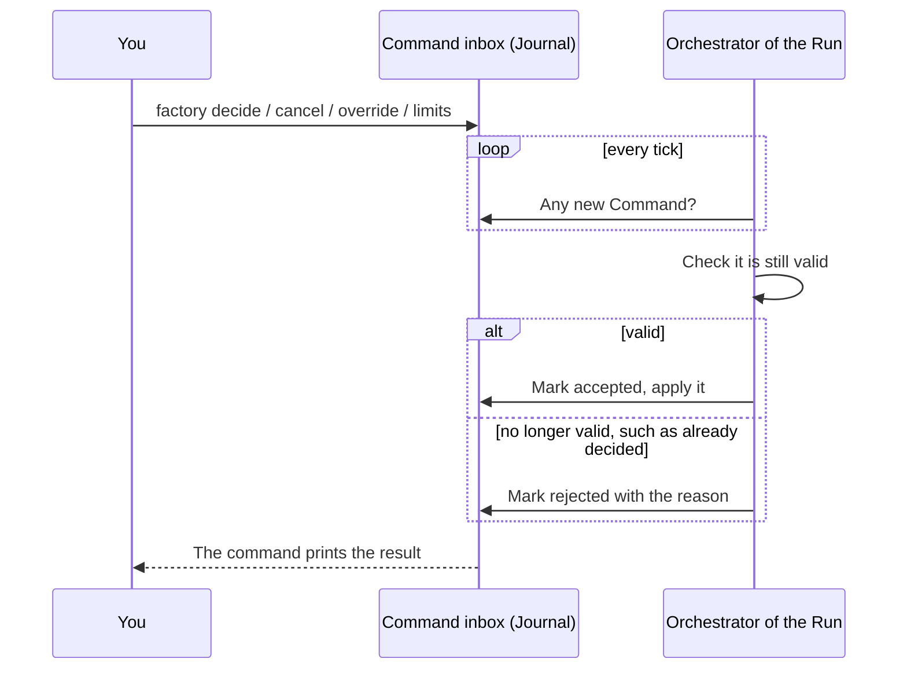
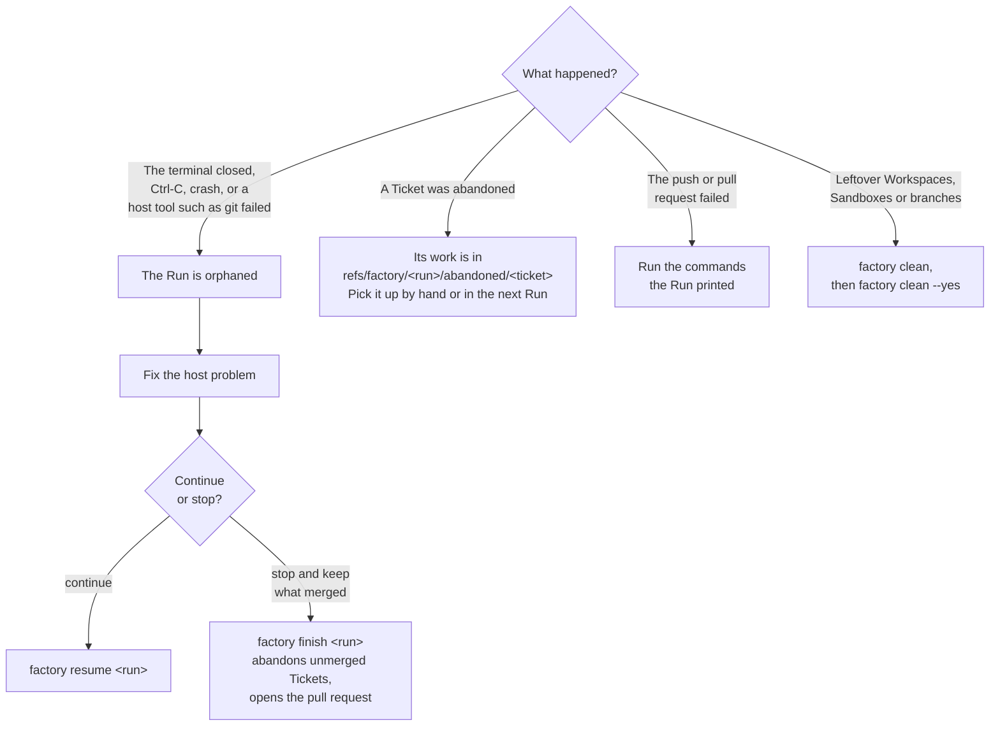

# 6. Running and steering

This page is the day-to-day reference.
It covers the one-time setup, writing a Spec the factory can work with, and every command you use while a Run goes.

## One-time setup

| Need | Command |
| --- | --- |
| macOS with Python 3.12+ and `uv` | `brew install uv` |
| The factory | `uv tool install git+https://github.com/Zepp333333/factory@main` |
| Claude Code with a subscription | See [claude.com/claude-code](https://claude.com/claude-code) |
| Docker Sandboxes, signed in | `brew trust docker/tap && brew install docker/tap/sbx`, then `sbx login` |
| Sandboxes that reach nothing by default | `sbx policy init deny-all` |
| Your subscription inside Sandboxes | `sbx run --name factory-login claude`, then `/login` and `/exit` in it, then `sbx rm -f factory-login` |
| GitHub access on the host | `gh auth status` |
| Or GitLab access on the host | `glab auth login --hostname <your host>`, see [gitlab.md](../gitlab.md) |
| A project file | Copy [`examples/tdd-review/factory.example.yaml`](../../examples/tdd-review/factory.example.yaml) to your repository as `factory.yaml`, see [page 5](05-customizing.md) |

Your login stays on the host, and agents in a Sandbox get only a placeholder.
[`docs/self-run.md`](../self-run.md) walks through each step in detail.

## Writing a Spec the factory can work with

On GitHub:

- The Spec is one issue that describes the feature as a whole.
- Each Ticket is a native sub-issue of the Spec.
- An order between Tickets is a native "blocked by" link.

On GitLab, Tickets are child Tasks of the Spec's issue, and the order goes in front matter, as [gitlab.md](../gitlab.md) explains.

The agents read only the Spec and the Ticket, so the text decides the result.
Good Tickets share a few traits:

- **A vertical slice.**
  Each Ticket delivers a small piece that works end to end, such as "export the orders table as CSV", not a horizontal layer such as "write all the models".
- **Acceptance criteria.**
  List what must be true when the Ticket is done.
  The reviewer and the `acceptance` Decision check the change against them.
- **Small enough for one agent.**
  A Ticket an engineer would finish in an hour or two fits well.
- **Explicit order.**
  If Ticket B builds on code from Ticket A, add the blocked-by link.
  Otherwise both start at once, and B builds on code that does not exist yet.
- **Disjoint where possible.**
  Tickets that edit the same lines at the same time end in conflicts, which cost a `resolve` Stage.

## Starting a Run

From the root of your repository, on an up-to-date base branch:

```sh
factory check                                   # validate factory.yaml and its Pipeline
factory run https://github.com/acme/shop/issues/120
factory run https://github.com/acme/shop/issues/120 --tickets 121,122
```

- `factory run` prints the Run id and the Integration branch, then keeps the terminal until the Run ends.
- `--tickets` takes only some sub-issues, so a large Spec can go in parts.
- A Ticket number that is not a sub-issue of the Spec stops the Run before it starts.
- So does an open blocker that is not part of the Run, because its Ticket would build on missing code.
- The Run blocks idle sleep while it is alive, but closing a laptop lid on battery still puts the computer to sleep.
  Keep the lid open or plug in a charger and an external display.

## Watching a Run

| Command | Shows |
| --- | --- |
| `factory status <run>` | Every Ticket with its node, Round and state, waiting Decisions, cost and duration |
| `factory status <run> --timeline` | The nodes each Ticket entered, in order |
| `factory attach <run> <ticket>` | The live terminal of the Ticket's latest agent |
| `factory stats <run> [<run> ...]` | Metrics of Runs, Stages and Tickets, and with `--by` a comparison of prompt or model variants |

With `workbench: orca` you also see each Workspace and agent terminal in the Orca IDE.

Costs shown are the API price equivalent of the tokens used.
On a subscription that is not money charged, but it tells you which Stages are expensive.

## Answering questions

A Ticket that reaches a human Decision waits for you while the others go on.
You find out in three places:

- the Run's terminal shows a question card and takes your choice as input
- the Tracker gets the card as a comment on the Ticket's issue and the label `factory:needs-human`
- `factory status` lists the waiting Decision

The card shows the Ticket, what led here, the latest verdicts, links to the inputs and the possible outcomes.
Answer from any terminal:

```sh
factory decide <run> <ticket> accept
factory decide <run> <ticket> rework --reason "The export must stream, not build the whole file in memory"
```

- An outcome that sends the Ticket back to work needs at least one `--reason`.
  The next agent reads it as its `cause`.
- While the Ticket waits, its Sandbox is stopped but its Workspace stays.
  You can edit and commit in the Workspace yourself, and the factory records your commits before it goes on.
  Do not rewrite the Ticket's history, or your answer is rejected.
- The wait has no timeout and holds no Slot.

### The Run's own questions

Two Decisions belong to the Run, not to a Ticket.
You answer them with `@run` in place of a Ticket.

| Decision | Opens when | Outcomes |
| --- | --- | --- |
| `infra_failure` | Agents of two different Tickets fail in a row with the same infrastructure cause, such as `auth` or `sandbox_start`, or one Ticket's agent runs out of memory twice | `retry` costs no Round, `abort` ends the Run `aborted` |
| `ci_failed` | CI on the final pull request is red, or still running after `ci.timeout` | `recheck` waits for CI on the current head again, `accept` ends the Run with the red CI recorded |

```sh
factory decide <run> @run retry
factory decide <run> @run recheck
```

Fix the cause first.
For `infra_failure` that may mean signing in again, restarting Docker or raising `sandbox.memory`.
For `ci_failed` it means pushing a fix to the Integration branch or rerunning a job, and then answering `recheck`.

## Steering a running Run

| Command | Effect |
| --- | --- |
| `factory cancel <run> <ticket>` | Abandons the Ticket. Tickets that depend on it never start. |
| `factory override <run> <ticket> <outcome> [--reason ...]` | Replaces the outcome of the Ticket's current or last Decision and stops the work that followed it |
| `factory limits <run> --max-parallel 3` | Changes how many Tickets work at once |
| `factory limits <run> --rounds fix=8` | Changes a Stage's Round limit |
| `factory limits <run> --cap five_hour=0.5 --pace seven_day=0.4` | Sets the throttle on a usage window |
| `factory limits <run> --no-throttle five_hour` | Lifts the throttle on a window |

Every one of these is a Command.
It goes into an inbox in the Journal, and the Run's Orchestrator accepts or rejects it on its next tick.
Edits in the Tracker, such as closing an issue, do not steer a Run.



A Command sent while the Run's process is dead waits in the inbox, and `factory resume` applies it.

## When something goes wrong



- `factory resume` rebuilds the Run from the Journal.
  An agent that was still running is stopped, and its Stage starts over with a new Attempt.
- `factory finish` keeps the unsaved work of each unmerged Ticket under its abandoned ref, ends the Run `partial` and lands the merged Tickets.
- `factory clean` lists what Runs that are no longer running left behind, and `--yes` removes it.
  A Workspace with uncommitted changes stays, and a branch with unmerged commits is saved under its abandoned ref first.

### Failure causes of an Attempt

`factory status` names why an Attempt failed.

| Cause | Meaning | What to do |
| --- | --- | --- |
| `timeout` | The agent ran past the Stage's `timeout`. | Raise `timeout`, or split the Ticket. |
| `stalled` | The agent produced nothing for longer than the Stage's `stall`. | Check for a hung test or command, or raise `stall`. |
| `oom` | The Sandbox ran out of memory. Spends no Attempt. | Raise `sandbox.memory`. |
| `sandbox_start`, `sandbox_lost` | The Sandbox did not start or died. Spends no Attempt. | Check Docker Sandboxes. |
| `auth` | The agent could not sign in. | Repeat the `/login` step of the setup. |
| `agent_config` | The agent loaded more than the factory's Agent kit. | Run `make test-contract` in the factory repository, see [self-run.md](../self-run.md). |
| `ignored_files` | The Stage left an ignored file outside `caches`. | Add the tool's cache directory to `caches`. |
| `rate_limited` | The subscription hit its limit. Spends nothing. | Nothing. New Attempts wait for the reset. |

## Command reference

| Command | What it does |
| --- | --- |
| `factory check [--project file] [--show role]` | Validates the project file and its Pipeline, or prints a Role's final prompt and schema |
| `factory run <spec> [--tickets 1,2]` | Starts a Run |
| `factory status <run> [--timeline]` | Shows a Run |
| `factory stats <run>... [--by field] [--stage name]` | Compares Runs and variants |
| `factory attach <run> <ticket>` | Follows the terminal of a Ticket's latest Attempt |
| `factory decide <run> <ticket or @run> <outcome> [--reason ...]` | Answers a waiting Decision |
| `factory cancel <run> <ticket>` | Abandons a Ticket |
| `factory override <run> <ticket> <outcome> [--reason ...]` | Replaces a Decision's outcome |
| `factory limits <run> [...]` | Changes parallelism, Round limits and the throttle |
| `factory resume <run>` | Continues an orphaned Run |
| `factory finish <run>` | Ends an orphaned Run and lands what merged |
| `factory clean [--yes]` | Lists, and removes, what ended Runs left behind |

Run `factory <command> --help` for every option.
