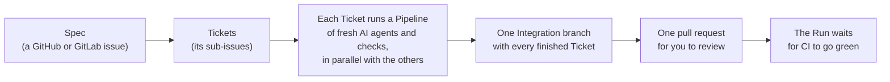

# Software Factory guide

This guide explains the Software Factory to someone who has never seen it.
It is for people who want to run the factory on their own project and shape it to fit.
You do not need to know how the engine is built to follow it.

## Reading order

| Page | What you learn |
| --- | --- |
| [1. Why the factory exists](01-why.md) | The problem it solves, its goals and what it leaves to you |
| [2. Glossary](02-glossary.md) | Every term the factory uses, with a map of how they relate |
| [3. How a Run works](03-how-a-run-works.md) | What happens from the moment you start a Run until its pull request is green |
| [4. Pipelines](04-pipelines.md) | How a Pipeline is built, node by node, with the default Pipeline walked through |
| [5. Adapting the factory to your project](05-customizing.md) | How to change commands, thresholds, models, prompts and whole Pipelines |
| [6. Running and steering](06-operating.md) | How to set up, start, watch, answer, recover and clean up a Run |

Pages 1 to 3 give you the mental model.
Pages 4 and 5 show you how to change the factory's behavior.
Page 6 is the day-to-day reference.

## The factory in one picture

You write the Spec and its Tickets.
The factory writes, checks and merges the code.
You review and merge the final pull request.

## Other documents

- [`CONTEXT.md`](../../CONTEXT.md) is the precise domain glossary the engine's code follows.
- [`docs/adr/`](../adr/) holds the architecture decision records, which explain why the design looks the way it does.
- [`docs/self-run.md`](../self-run.md) walks through a full setup, using the factory's own repository as the Target project.
- [`docs/gitlab.md`](../gitlab.md) covers Specs published in GitLab.
